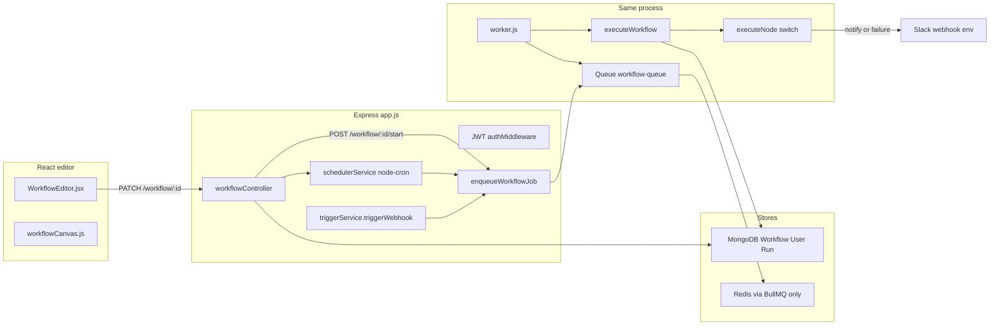
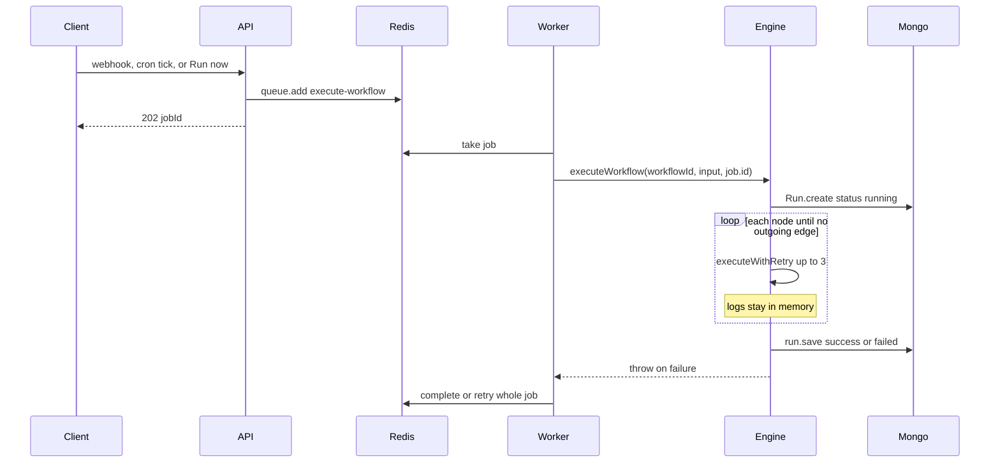

# Workflow Builder Architecture

Architecture audit for extending this repository with an AI development lifecycle:

**Jira → AI Analysis → Cursor Prompt → Human Approval → Git Branch/Worktree → Cursor Agent → Playwright → GitHub PR (execution completes) → Human Merge.**

This document describes the code as it was inspected. It does not replace BullMQ, Redis, or the current execution engine. Section 15 is the revision contract for resume atomicity, approval races, lease release on wait, Playwright repository layout, agent isolation, the git lifecycle, Playwright reproducibility, credential redaction, Jira idempotency, agent completion, and the pull-request gate. Where an earlier paragraph and section 15 disagree, section 15 wins. Phase 1 refinement 2 and the lease-lifetime sequence in section 14 are not amended. Status labels used throughout:

- **Already implemented**
- **Partially implemented**
- **Not implemented**
- **Requires further investigation**

This file is an architecture audit. It is not independent confirmation that every observation still matches the repository. Before implementing any change, re-read the source files named in that step and treat the code as the source of truth if it disagrees with this document. The files to recheck first are `src/services/executionengine.js`, `src/models/Run.js`, `src/workers/worker.js`, `src/services/queue.js`, `src/services/enqueueWorkflowJob.js`, `src/nodes/index.js`, and `src/utils/workflowGraph.js`.

The lifecycle can sit on the existing engine. It cannot pause, resume, or call an external agent safely until `executeWorkflow`, the node switch, and the `Run` document are extended. There is one queue, one in-process worker, and four node types. Nothing in the repo talks to Jira, Cursor, Git, GitHub, or Playwright.

`implementation.md` is the build plan. Where that file changes a choice below, this document is updated to match. The lease, checkpoint, approval, and phase-gate rules are unchanged.

Source inspection on 2026-10-31, before the Phase 1 code change, confirmed sections 1–6. `executeWorkflow` still inserts a new `Run` and calls `save()` at the end. `Run` has no cursor or lease fields. `validateWorkflowGraph` does not reject cycles. The HTTP node has no timeout. Require paths still use the mixed-case strings in the Linux-filename table. `npm test` exits 1. Git already stores the lowercase filenames (`executionengine.js`, `workflow.js`, `workflowRoutes.js`, `workflowController.js`). The installed BullMQ is 5.74.1. Those Phase 1 gaps are the code change in `implementation.md`. This paragraph does not mark Phase 1 complete.

## Binding design constraints

These rules govern the lifecycle. Later sections say where they land in the current code. None of them are implemented yet.

1. **Reliability before agents.** Fix retry collisions on `Run.jobId`, crash recovery, per-node checkpoints, and cycle detection in `validateWorkflowGraph` before any Cursor or Playwright worker is added. Phase 1 and Phase 2 in the phase completion gates must be marked complete first. Do not start agent work while a retry can insert a second `Run` or a crash can leave a run stuck on `running`.

2. **Human approval is a workflow state, not a notification.** The run must pause, persist `status: "waiting"` with the full context and `currentNodeId`, survive a process restart, and resume only after an authorized decision. The existing notify node and `maybeNotifyRunFailure` may alert the reviewer. They do not approve the run and they do not pause the walker.

3. **Cursor and Playwright run on their own workers.** `workflow-queue` only enqueues `agent-queue` and `playwright-queue`, checkpoints, and returns. The main workflow worker must not stay blocked while the agent or the browser suite executes. The agent worker and the Playwright worker then enqueue `resume-workflow` on `workflow-queue`. They do not call this API over HTTP.

4. **One isolated Git worktree per run.** Concurrent runs, including two runs of the same Jira issue, do not share a branch or a working directory. `gitService` creates a worktree for that run’s branch and the agent receives only that path. The agent must not operate on the main checkout, another run’s worktree, the workflow checkout, or the developer’s home directory. Section 15 item 6 is the git contract.

5. **Credentials and execution stay isolated.** Deleting environment variables is not the sandbox. The agent runs in an OCI container whose mounts, network, and account are limited to that one worktree, as defined in section 15 item 5. Jira, GitHub, and analysis tokens stay in the workflow worker. The agent worker does not open MongoDB. The Cursor API key is passed only into that container. The workflow worker may already hold a BullMQ connection it opened with the Redis password.

6. **A pull request depends on a successful Playwright result for this run and this revision, and a human merges.** `githubPr` is not reachable by any other graph path. The node also checks at runtime that `external.playwrightByNode` for the predecessor Playwright node is `passed` for this run and for the revision that was tested. The automation opens the pull request. It does not merge. Merging waits for human review on that pull request. This review is separate from the earlier approval node, which gates the agent before any code is written.

---

## 1. Current architecture

A run is one BullMQ job that walks the graph in memory and writes the `Run` document once at the end.





### Technology stack

| Layer | What is in the repo |
|---|---|
| API | Node.js, Express 5, `app.js` |
| Data | Mongoose 9, MongoDB |
| Jobs | BullMQ 5, Redis. The `ioredis` package is a dependency and is never imported directly |
| Scheduler | `node-cron` inside the API process |
| Auth | JWT (`jsonwebtoken`), scrypt passwords |
| HTTP client | `axios` (HTTP node, Slack) |
| UI | React 18, Vite, React Router, `@xyflow/react` |
| Tests | **Not implemented.** `npm test` exits 1 |
| Deploy | **Not implemented.** No Dockerfile, compose file, or CI workflow |

`npm start` and `npm run dev` both run `app.js`, which loads the queue and the worker in the same process.

### Linux filename case

**Requires further investigation** on the actual deploy host. These `require` paths resolve on Windows and fail on a case-sensitive filesystem:

| Require path | File on disk |
|---|---|
| `app.js` → `./src/routes/WorkflowRoutes` | `src/routes/workflowRoutes.js` |
| `app.js` and `src/workers/worker.js` → `executionEngine` | `src/services/executionengine.js` |
| `src/routes/workflowRoutes.js` → `../controllers/WorkflowController` | `src/controllers/workflowController.js` |

---

## 2. Repository folder structure

```
workflow-builder/
  app.js
  config/index.js
  package.json
  architecture.md
  Workflow-Builder.postman_collection.json
  src/
    controllers/   authController, userController, workflowController,
                   triggerController, RunController
    middlewares/   authMiddleware.js
    models/        User.js, workflow.js, Run.js, RevokedToken.js
    nodes/         index.js
    routes/        authRoutes, userRoutes, workflowRoutes,
                   triggerRoutes, runRoutes
    services/      executionengine.js, queue.js, enqueueWorkflowJob.js,
                   triggerService.js, schedulerService.js
    utils/         workflowGraph.js, password.js, authToken.js, userInput.js
    workers/       worker.js
  frontend/
    src/pages/     Login, Register, Dashboard, Profile,
                   WorkflowEditor, WorkflowRuns, WorkflowRunDetail
    src/components/nodes/  HttpNode, ConditionNode, DelayNode, NotifyNode
    src/lib/       api.js, workflowCanvas.js, payloadForms.js, cronPicker.js
  docs/            project notes only; not runtime
```

---

## 3. Important source files

| File | Responsibility |
|---|---|
| `app.js` | Express, CORS, JSON body, Mongo connect, mounts routes, calls `startScheduler()`, loads queue and worker |
| `config/index.js` | `MONGODB_URI`, `JWT_SECRET`, Redis host/port/password, `SLACK_WEBHOOK_URL`. `uploadsDir` is unused |
| `src/models/workflow.js` | Draft/published graph: `nodes[]`, `edges[]`, `trigger` |
| `src/models/Run.js` | One execution record: `jobId`, status, step `logs` |
| `src/models/User.js` | `name`, `email`, scrypt password. No roles |
| `src/models/RevokedToken.js` | TTL index on `jti`. Nothing in the repo inserts a row |
| `src/nodes/index.js` | `executeNode`, `getAtPath`, `evaluateCondition`, `interpolateMessage` |
| `src/services/executionengine.js` | `executeWorkflow`, `executeWithRetry`, `getNextNode`, Slack failure alert |
| `src/services/queue.js` | BullMQ `Queue("workflow-queue")` and default job options |
| `src/services/enqueueWorkflowJob.js` | `queue.add("execute-workflow", { workflowId, input }, extraOptions)` |
| `src/workers/worker.js` | Consumes `workflow-queue`, calls `executeWorkflow` |
| `src/services/schedulerService.js` | In-process `node-cron` tasks synced from published cron workflows |
| `src/services/triggerService.js` | `triggerWebhook`: publish, pause, and secret checks, then enqueue |
| `src/controllers/workflowController.js` | CRUD, `publishWorkflow`, `setTriggerEnabled`, `startWorkflow` |
| `src/utils/workflowGraph.js` | `validateWorkflowGraph` on publish |
| `src/middlewares/authMiddleware.js` | Bearer JWT, optional revocation lookup |
| `frontend/src/pages/WorkflowEditor.jsx` | XYFlow canvas, inspector, save, publish, pause, Run now |
| `frontend/src/lib/workflowCanvas.js` | Node defaults and API graph mapping, including `__ui.position` |
| `frontend/src/lib/api.js` | Axios client and route helpers |

---

## 4. How the engine works

### Node registration

**Already implemented, as a switch, not a registry.**

Backend types are the `switch (node.type)` in `executeNode` (`src/nodes/index.js`). Unknown types throw `Unknown node type`. The editor has a second list: `nodeTypes` and `addNode` in `frontend/src/pages/WorkflowEditor.jsx`, plus `defaultConfigForType` and `labels` in `frontend/src/lib/workflowCanvas.js`. Adding a type means editing both places. There is no plugin loader.

### Node contract

**Already implemented, informally.**

A node is `{ id, type, config }`. The only execution function is `executeNode(node, input)` in `src/nodes/index.js`. It returns a value or throws. There is no class, no `validate()`, and no declared input or output schema.

### Inputs and outputs

**Already implemented, as one replaceable value.**

`executeWorkflow` starts with the job payload. After each successful node, `inputData = output`, then `getNextNode(workflow, currentNode, output)` picks the next node. The start node is the single node with no incoming edge.

| Type | Uses `input`? | Returns |
|---|---|---|
| `http` | No. Calls `cfg.method`, `cfg.url`, `cfg.headers`, `cfg.body` | `res.data`, which replaces the payload |
| `condition` | Yes, via `getAtPath` | A boolean. The next node receives `true` or `false`, not the previous object |
| `delay` | Yes | The same `input` after an in-process sleep, clamped to 0–60 seconds |
| `notify` | Yes, for `{{dot.path}}` in `cfg.message` | The same object, or `{ payload: input }` |

`http` has no `{{ }}` substitution. Only `interpolateMessage` in the notify branch does. A Jira body cannot be forwarded into the next HTTP call with the current HTTP node.

### Execution state

**Partially implemented.**

`Run.create` writes `status: "running"` immediately. Step logs are pushed on the in-memory document and `run.save()` runs only after the walk finishes or throws. Each log stores `JSON.stringify(...).slice(0, 200)` for input and output. The schema allows `running | success | failed` only. There is no `currentNodeId`, full payload, or attempt counter.

### Pause and resume at a node

**Not implemented.**

Pause in the product is `trigger.enabled`. `setTriggerEnabled` and `triggerWebhook` reject new webhook and manual starts. `syncCronSchedulesFromDb` drops cron tasks while paused. A job already inside `executeWorkflow` runs to the end. Resume-from-failed-step is not in the code.

### Restart safety

**Not implemented.**

The worker passes `String(job.id)` into `executeWorkflow`, and `Run.jobId` is unique. BullMQ is configured with `attempts: 3` and exponential backoff starting at 2000 ms. After the first attempt has inserted a `Run`, a retry calls `Run.create` again with the same `jobId` and hits the unique index. There is no `worker.close()` on shutdown, no checkpoint, and no resume cursor. A kill mid-run leaves `status: "running"` and empty `logs`.

### Long-running work

**Partially implemented, and it blocks the worker.**

The worker is constructed with `{ connection }` only, so BullMQ defaults apply: concurrency 1, lock duration 30 seconds. `delay` can sleep up to 60 seconds inside that job. The HTTP node uses axios with no timeout. There is no delayed job, no second queue, and no `job.extendLock`. A step longer than the lock can be marked stalled and delivered again while the first attempt is still inside the loop.

### Duplicate webhooks

**Not implemented.**

`triggerWebhook` always calls `enqueueWorkflowJob(workflowId, req.body)`. Callers never pass `extraOptions.jobId`, even though `enqueueWorkflowJob` already forwards a third argument to `queue.add`. There is no event-id store. Redis is not used for idempotency keys. Redis exists only as the BullMQ connection in `config.redisConnection`.

### Condition edges

**Partially implemented.**

The editor warns in `branchHints` when a split is missing `true` / `false`. `getNextNode` enforces that at runtime if a node has more than one outgoing edge: `result === true` selects `condition: "true"`, anything else selects `"false"`. `validateWorkflowGraph` does not check those labels, and it does not reject cycles. A cycle stays in the `while (currentNode)` loop until the process is killed.

### Authentication and authorization

**Partially implemented.**

Register and login issue a 7-day JWT with a `jti`. `authMiddleware` rejects a `jti` found in `RevokedToken`. No code inserts a revoked token. Logout in `frontend/src/context/AuthContext.jsx` only clears `localStorage`. Workflows and runs are filtered by `userId`. There are no roles, orgs, or integration accounts. Webhooks are public aside from an optional `x-webhook-secret`, compared with `!==`.

### Notifications and logs

**Already implemented, narrowly.**

Notify and run-failure alerts post to `SLACK_WEBHOOK_URL`. If that env var is missing, notify returns the payload with `_notifySkipped: true` and does not fail the run. Run history is `GET /workflow/:id/runs` and `GET /runs/:runId`, rendered by `WorkflowRuns.jsx` and `WorkflowRunDetail.jsx`. Logs are truncated. The Vite proxy in `frontend/vite.config.js` forwards `/auth`, `/workflow`, `/user`, and `/webhook`, and does not forward `/runs`. With `VITE_API_URL` set, as in `frontend/.env.example`, the client calls the API directly and the missing proxy entry does not matter.

### Errors and recovery

**Partially implemented.**

Node failures retry 3 times inside `executeWithRetry` with no delay, then the run is saved as `failed`, Slack is attempted, and the error is rethrown so BullMQ retries the whole job. Publish validation is `validateWorkflowGraph` plus a non-empty cron string. There is no recovery API.

### Deployment

**Not implemented beyond local Node.**

Config is `.env`. API and worker share one process. Every process that runs `app.js` also runs `node-cron`, so two instances double-fire schedules. `cors()` is open.

---

## 5. Existing reusable modules

Use these. Do not add a second workflow engine.

| Module | Reuse for the lifecycle |
|---|---|
| `executeNode` switch | Register `jira`, `analysis`, `cursorPrompt`, `approval`, `gitBranch`, `cursorAgent`, `playwright`, `githubPr` |
| `executeWorkflow` loop and `getNextNode` | Keep the walker. Teach it to stop on a wait and to start again from a saved node |
| `enqueueWorkflowJob` | Queue the first run and every resume. Pass `extraOptions` for `jobId` and resume payload |
| `queue.js` / `worker.js` | Keep `workflow-queue`. Add sibling BullMQ queues on the same Redis for agent and Playwright work |
| `Run` | Extend this document. Do not invent a parallel execution store |
| `triggerWebhook` + `x-webhook-secret` | Pattern for the Jira Automation webhook. Agent and Playwright completion enqueue resume; they do not call this route |
| `interpolateMessage` / `getAtPath` | Template short notify text. Prompt bodies use a separate helper; the 200-character object slice in `interpolateMessage` is for Slack |
| `maybeNotifyRunFailure` and the notify node | Approval and failure alerts |
| `validateWorkflowGraph` | Extend publish checks for the new types |
| `workflowCanvas.js` + `WorkflowEditor.jsx` | Palette, inspector, persistence of `config` and `__ui` |
| `config/index.js` | Env-backed secrets, same pattern as `SLACK_WEBHOOK_URL` |

Published graphs are frozen by `updateWorkflow` and `replaceWorkflow`. New node types only run after a draft is published. Existing HTTP, condition, delay, and notify behavior has to stay as it is.

---

## 6. Missing capabilities

| Capability | Status |
|---|---|
| Jira, Cursor, Git, GitHub, Playwright clients | Not implemented |
| Human approval node and waiting run | Not implemented |
| Checkpoint and resume from a node | Not implemented |
| Safe restart of an in-flight run | Not implemented |
| Webhook idempotency | Not implemented |
| Payload carried through a condition | Not implemented. Condition replaces data with a boolean |
| HTTP templating from prior output | Not implemented |
| Secret redaction on workflow reads | Not implemented. Webhook secrets, HTTP `Authorization` headers, and other secret-like node config fields are returned by every workflow JSON response. The required redaction contract is section 15 item 8. Lifecycle tokens belong in the environment |
| External process sandbox | Not implemented. HTTP can call any URL, with no allowlist and no timeout |
| Isolated Git worktree per run | Not implemented. No Git client exists |
| Pull request opened only after Playwright success, with no auto-merge | Not implemented |
| Second BullMQ queue / worker role | Not implemented. `worker.js` is the only consumer, and it runs inside `app.js` |
| Workflow versioning | Not implemented |
| Roles beyond owner | Not implemented |
| Token revocation write path | Partially implemented. Read path exists, write path does not |
| Deployment unit | Not implemented |
| Automated tests | Not implemented |

---

## 7. Required backend modifications

All of these extend the current walker.

1. **`src/services/executionengine.js` — `executeWorkflow`.** Phase 2 accepts an optional resume cursor on the job: `{ workflowId, input, runId, startNodeId }`. Phase 1 reloads by the BullMQ `job.id` already stored on `Run.jobId` and does not change the queue payload. On a fresh run, keep `Run.create`, then save `currentNodeId` and `context` before the first node. On a repeated `job.id`, load that `Run` and start at `currentNodeId`. When the current node asks to wait, `persistWaitingRun` saves `status: "waiting"`, `currentNodeId`, and the full payload, releases the execution claim, and the function returns without throwing so BullMQ marks the job complete. A redelivery of that same `execute-workflow` job, while the row is still `waiting`, returns without acquiring the claim and without walking. Throwing restarts the graph and then collides on `jobId`. Waiting is Phase 2. Phase 1 takes the `executionClaim` lease from section 13 before it advances the row, and renews that lease while `executeWithRetry` is running.

2. **`getNextNode`.** Keep `result === true` / `false` for the existing condition node. For object results, branch only when the node sets an explicit flag such as `result.branch === "true"` or `"false"`. An approval node that returns the previous object must not fall through to the false edge.

3. **`src/nodes/index.js`.** Add cases that call service modules and return the merged payload. Approval returns `{ ...input, approval }` and a branch flag, or signals wait before anyone has decided. Do not shell out from this function.

4. **`src/workers/worker.js`.** Pass `job.data` through, including `runId` and `startNodeId`, when Phase 2 resume jobs exist. Phase 1 recovery uses the same BullMQ `job.id` already stored on `Run.jobId`. Set `lockDuration` explicitly to 30000 and `lockRenewTime` to `Math.floor(lockDuration / 2)`. That matches BullMQ 5.74.1’s own default formula. Do not raise `lockDuration` to cover the whole graph: a living process already renews the lock, and a longer lock delays redelivery after a crash. Cursor and Playwright must not run inside this worker. It persists the wait and releases the claim, then enqueues `agent-queue` or `playwright-queue`, and returns. `settle-wait` and `resume-workflow` are the same worker. Concurrency for those queues is set on their own Worker options. Add the agent and Playwright workers only after constraints 1 and 2 are in place.

5. **`src/services/queue.js`.** Keep `workflow-queue` and its retry defaults. Add `agent-queue` and `playwright-queue` with their own attempts, timeouts, and `removeOnComplete` / `removeOnFail` policy. Use the same `config.redisConnection`.

6. **`src/services/enqueueWorkflowJob.js`.** Callers that need deduplication pass `extraOptions.jobId`. Jira uses `jira_<issueId>_<eventId>` after the canonical issue id is loaded from Jira, as defined in section 15 item 9. Resume and settle jobs need their own ids so they do not collide with the original run’s unique `Run.jobId`. A custom id must match `^[A-Za-z0-9_-]+$`. BullMQ uses `:` inside Redis keys, so an id that contains `:` is rejected. Stripping characters out of an id is not allowed: two different ids can collapse into one.

7. **`src/services/triggerService.js`.** When `trigger.config.provider` is `"jira"`, apply the idempotency rules in section 15 item 9. Compare secrets with `crypto.timingSafeEqual` on SHA-256 digests so a different length does not throw or return early. Agent and Playwright completion do not enter through this service. Their workers enqueue `settle-wait` on `workflow-queue`. The workflow worker writes the completion and then enqueues `resume-workflow`.

8. **`src/utils/workflowGraph.js`.** On publish, require condition and approval splits to have one `true` and one `false` edge, and reject cycles. Cycle rejection covers every component, including a cycle that the start node cannot reach. Reject node configs that embed tokens. The split-label and embedded-token checks stay with the later node types. Phase 1 adds cycle rejection only.

9. **`src/services/schedulerService.js`.** Leave cron on `node-cron` until more than one API process is running. Then move schedules to BullMQ job schedulers so ticks are not duplicated. That is a scaling fix, not a second engine.

10. **Fix `Run.create` versus retries** in `executeWorkflow` before any long job is added. A repeated `job.id` must reload the existing run or be ignored. Today the unique index makes BullMQ’s `attempts: 3` fail the retry after the first insert. Phase 1 continues that row from its checkpoint. The checkpoint is at-least-once: a crash after a side effect and before `save()` can repeat that side effect. An atomic `executionClaim` lease is required so two workers cannot both advance the row. The lease lifetime, including renewal while a node is still running, is refinement 2 in section 13.

11. **Normalize require paths** in Phase 1, before tests run on Linux. Change the `require` strings to the filenames on disk (`executionengine.js`, `workflow.js`, `workflowRoutes.js`, `workflowController.js`). Do not case-rename the files. On Windows, Git will not record a case-only rename.

### How to add a Human Approval node

**Not implemented today.** This is a core execution state, not another notify step. Slack can tell a person that a decision is waiting. The run stays `waiting` until `POST /runs/:runId/decision` succeeds. A restart must reload that same `Run` and keep waiting. It must not start the graph again from the first node.

Extend the existing engine:

- Add type `approval` to the `executeNode` switch. The case returns `{ control: "wait", kind: "approval", output }` with the current payload. It does not throw. `executeWithRetry` would treat a throw as a failed attempt. It does not call an agent and it does not create a branch.
- `executeWorkflow` persists `status: "waiting"`, `currentNodeId`, `wait.kind: "approval"`, and the full `context`, then returns so the BullMQ job completes. Do not throw. A throw retries the whole job and collides on `Run.jobId`.
- `POST /runs/:runId/decision` in `src/controllers/RunController.js` checks `Workflow.userId === req.user.id` (same rule as `getRunById`). The winning decision is one conditional update on the still-pending approval wait, through `settleWait` in `src/services/waitCompletion.js`. A losing or repeated decision returns HTTP 409 and does not enqueue resume. The protocol is section 15 items 1 and 2.
- Resume loads that `Run`. `beginResume` continues only when this job’s id is the pending resume for that wait. A second resume does not walk the graph.
- Approve and reject use the existing `true` / `false` edge labels once `getNextNode` can read an explicit branch flag on an object result. The condition node must keep returning a boolean so current graphs stay valid.
- Reject ends the lifecycle. It does not create a worktree, enqueue Cursor, or open a pull request.

### How to run an external agent safely

The HTTP node is the wrong place for this. It ignores prior input, has no timeout, and calls any URL stored in the graph. Do not add this worker until retry collisions, checkpoints, and approval resume are in place.

Use `@cursor/sdk` on the local runtime inside the container from section 15 item 5. The call is `Agent.create`, then `agent.send`, then `run.wait`, so the agent id and run id exist before the run finishes. `Agent.prompt` is not used: it does not return those ids until the call completes, which is too late to recover a crash. Cloud agents clone their own checkout and can open a pull request themselves, which skips the worktree and the Playwright gate. The repository is CommonJS, and the SDK is ESM, so the host consumer is `src/workers/agentWorker.mjs` and the in-container entry is `scripts/agent-sandbox-entry.mjs`. `app.js` does not load either file.

- The workflow node persists the wait, releases the execution claim, enqueues `agent-queue`, and returns. `src/workers/worker.js` does not run Cursor and does not sleep until it finishes.
- The container entry calls `Agent.create` with an explicit `apiKey`, `model: { id: "composer-2.5" }` unless `CURSOR_MODEL` overrides it, and `local: { cwd: "/worktree", settingSources: [] }`. There is no `cloud` option. `settingSources: []` keeps project and user settings out of the run. It is not a filesystem or network sandbox. The local SDK otherwise reuses the machine’s environment and credentials, which is why the container is mandatory.
- The prompt is a string argument. It is never interpolated into a shell command. Host spawns in this lifecycle use `shell: false`. A shell the agent starts can see only the container mounts.
- The working directory is this run’s worktree, not the repository’s main checkout. Two agents must not see each other’s files.
- `result.status === "finished"` is not proof of a code change. Section 15 item 10 is the completion check. Failure follows the node’s `false` edge and does not open a pull request. The entry disposes the agent in `finally`.

### How to run Playwright

**Not implemented.** Tests are not assumed to live in the application worktree. The playwright node must set `config.strategy` to `in-repo` or `external-repo`. A missing strategy fails publish. Section 15 items 4 and 7 are the contract. This repository does not add a Playwright dependency and does not call another product’s HTTP API.

`src/workers/playwrightWorker.js` consumes `playwright-queue` and starts the Playwright container. It does not spawn the suite on the host with the workflow environment. The workflow job checkpoints, releases the claim, and exits. `workflow-queue` must not block on the browser suite. Only a verified pass, with a report and the tested revision, is `passed`. Dependency and browser bootstrap failures, timeouts, and a missing report are not test failures and are not `passed`. The worker enqueues `settle-wait`. `githubPr` stays behind the gate in section 15 item 11.

---

## 8. Required frontend modifications

| Place | Change |
|---|---|
| `frontend/src/lib/workflowCanvas.js` | `defaultConfigForType`, labels, and `executionConfigFromNodeConfig` for each new type |
| `frontend/src/pages/WorkflowEditor.jsx` | `nodeTypes`, `addNode` labels, inspector panels, palette buttons beside HTTP / Condition / Delay / Notify |
| `frontend/src/components/nodes/*.jsx` | One presentational node per type, same Handle pattern as `HttpNode.jsx` |
| `frontend/src/lib/api.js` | `approve`, `reject`, and integration-status calls. Run now currently posts `{}` |
| `frontend/src/pages/WorkflowRunDetail.jsx` | Render `waiting`, the pending prompt, and approve/reject when `run.status === "waiting"` |
| `frontend/src/pages/WorkflowRuns.jsx` | Show waiting runs. The list is loaded once. It does not poll |
| `frontend/vite.config.js` | Proxy `/runs` if the UI is ever used without `VITE_API_URL` |

The inspector already patches `node.data.config` and `nodeToBackend` persists it, including `__ui.position`. New fields belong in that config object only when they are not secrets.

---

## 9. Required MongoDB schema changes

### `Workflow` (`src/models/workflow.js`)

**Partial change.** `nodes[].type` and `nodes[].config` are untyped, so new types fit. Do not store API tokens in `config`. Optional later: `integrations` references, still not the secret itself. `trigger.type` remains `webhook | cron`.

### `Run` (`src/models/Run.js`)

**Required change.**

| Field | Purpose |
|---|---|
| `status` enum add `waiting` | Phase 2. Approval, agent, or Playwright hold. Keep `running`, `success`, `failed` through Phase 1 |
| `currentNodeId` | Phase 1 resume cursor. The node about to run |
| `context` | Phase 1 full payload. Logs truncated to 200 characters cannot rebuild it |
| `executionClaim` | Phase 1 lease token. Acquire mints it. Renewal and every checkpoint match this exact token. Takeover replaces it |
| `executionClaimExpiresAt` | Phase 1 lease expiry. Acquire sets it to MongoDB `$$NOW` plus `executionClaimLeaseMs` (default 30000). Renewal moves it forward only while it is still after `$$NOW`. A missing, null, or elapsed value can be claimed |
| `wait.kind` | `approval`, `agent`, or `playwright` |
| `wait.nodeId` | The graph node that owns this wait. Required when the graph has more than one node of that type |
| `wait.state` | `pending`, `completing`, or `resumed`. Only `pending` accepts a completion |
| `wait.externalJobId` | Id minted with the wait. Approval, agent, and Playwright completions must present this id |
| `wait.resumeJobId` | `resume-<kind>-<runId>-<nodeId>`. One resume job for this wait |
| `wait.completion` | The winning result. A later completion does not replace it |
| `pendingResume` | Outbox for the resume job: `resumeJobId`, `payload`, `enqueuedAt`. `enqueuedAt: null` means Redis may not have the job yet |
| `approval` | `decision`, `userId`, `decidedAt`. Written only by the winning conditional update |
| `external.worktreePath`, `external.branch` | This run’s checkout and branch, not a branch shared by every run of the issue |
| `external.preAgentSha`, `external.agentExecutionId`, `external.agentSha` | Agent retry and commit verification. Section 15 item 10 |
| `external.testedSha` | Revision recorded before Playwright and required again before push and `githubPr` |
| `external.playwrightByNode` | Per Playwright node: `status`, `testedSha`, `failureClass`, `reportPresent`. Status is `passed`, `failed`, `timed-out`, or `bootstrap-failed` |
| `external.prUrl` | Set only after the pull-request gate passes |

`jobId` must stay unique for the first queue job. Resume jobs need a different id, or the resume path must update the existing row instead of inserting another `Run`.

Phase 1 checkpoints are at-least-once. `currentNodeId` and `context` record the last save that landed. A node that called the network and then crashed before `save()` runs again on redelivery. Phase 1 does not add idempotency keys. Side-effecting integrations in later phases have to supply their own keys. Old `Run` documents have none of the new fields. A missing `currentNodeId` is resumed from the indegree-0 node using the job input. Truncated logs are not a cursor.

### Credentials

**No `Integration` collection.** This product has one owner. Provider tokens live in the environment. A Mongo secret store would need encryption, rotation, and a path that workflow reads cannot reach, and none of that is required for a single owner. Every workflow JSON response omits secret values and keeps a boolean indicator, as defined in section 15 item 8. Webhook secrets and HTTP authorization headers today are stored on the workflow and returned to the browser.

### `User`

**No change required** for a single owner approving their own run. Roles are not in the schema.

### `RevokedToken`

**Already present.** Wiring logout to insert `jti` is separate from the lifecycle. The middleware already reads it. Nothing writes it.

---

## 10. Required BullMQ jobs and workers

| Job | Queue | Status | Worker behavior |
|---|---|---|---|
| `execute-workflow` | `workflow-queue` | Already implemented | `worker.js` calls `executeWorkflow`. Extend the payload with `runId` and `startNodeId`. Do not throw on an intentional wait. Persisting `waiting` releases the execution claim |
| `settle-wait` | `workflow-queue` | Not implemented | Same worker. Runs `settleWait`: the atomic completion write, then the resume enqueue. Agent and Playwright workers enqueue this job. They do not write MongoDB |
| `resume-workflow` | `workflow-queue` | Not implemented | Same worker. `beginResume` claims the row once, then continues at `wait.nodeId` |
| `cursor-agent` | `agent-queue` | Not implemented | `agentWorker.mjs` starts the agent container, then enqueues `settle-wait`. The workflow worker only enqueues this job and does not run Cursor |
| `playwright-suite` | `playwright-queue` | Not implemented | `playwrightWorker.js` starts the Playwright container for the node’s strategy, then enqueues `settle-wait`. The workflow worker only enqueues this job |
| Jira dedupe | `workflow-queue` | Not implemented | `queue.add(..., { jobId: jira_<issueId>_<eventId> })` from section 15 item 9 |

Keep `attempts`, backoff, and `removeOnComplete: { count: 1000 }` for the workflow queue. Agent and Playwright jobs need their own attempt caps so a failed browser run does not re-execute the Jira and git steps. `removeOnFail: false` is already set on the workflow queue.

Cron stays a producer of `execute-workflow`, as `schedulerService.js` does now.

Redis stays the BullMQ backend. Do not replace it. Do not add a second workflow engine.

---

## 11. Proposed service interfaces

None of these modules exist. Implement them under `src/services/` and call them only from `executeNode` cases.

```javascript
// src/services/jiraService.js — axios to Jira REST API v3. No Jira SDK.
async function fetchIssue(issueKey) {}
function verifyWebhookSecret(headerValue) {}

// src/services/analysisService.js — OpenAI-compatible JSON call, validated with zod.
// This is not a Cursor agent. The agent can edit files and must stay behind approval.
async function analyzeIssue(issue) {}

// src/services/cursorPromptService.js
function buildPrompt(analysis, issue) {}

// src/services/waitCompletion.js
// The only completion protocol for approval, agent, and Playwright waits.
async function settleWait({ runId, kind, nodeId, externalJobId, result }) {}
async function enqueuePendingResumes() {}

// src/services/approvalService.js
// Calls settleWait. A null update is HTTP 409. Only the winner enqueues resume.
async function recordDecision(runId, decision, userId) {}

// src/services/gitService.js — child_process.spawn("git", args, { shell: false }).
// No simple-git. Never reuses the main checkout. Section 15 item 6.
async function createWorktree(repo, baseBranch, branchName, runId, nodeId) {}
async function removeWorktree(worktreePath) {}
async function pushBranch(worktreePath, branchName, testedSha) {}
async function reconcileWorktrees() {}

// src/services/cursorAgentService.js
// Enqueues agent-queue. Does not import @cursor/sdk. The ESM worker does.
async function enqueueAgent(runId, nodeId, prompt, worktreePath, externalJobId) {}

// src/services/playwrightService.js
async function enqueueSuite(runId, nodeId, worktreePath, strategy, externalJobId) {}

// src/services/githubPrService.js — @octokit/rest. No merge method.
async function openPullRequest(repo, head, base, title, body) {}
```

Suggested node order on one published workflow:

1. `jira` — load the issue into `context`
2. `analysis` — produce an analysis object
3. `cursorPrompt` — produce prompt text with `cursorPromptService` and a delimited untrusted-data block. Do not use `interpolateMessage`
4. `approval` — pause, persist, and resume only after a human decision
5. `gitBranch` — after approval (`true` edge), create this run’s branch and an isolated worktree
6. `cursorAgent` — enqueue `agent-queue` against that worktree and wait
7. `playwright` — enqueue `playwright-queue` for the node’s explicit test strategy and wait
8. `githubPr` — open the pull request only when this run’s Playwright gate passes. Do not merge
9. Existing `notify` — send the PR URL for human review before anyone merges

---

## 12. Security and credential management

**Already in place:** scrypt passwords (`src/utils/password.js`), JWT on protected workflow and run routes, owner checks, optional webhook secret, Slack URL only in the environment.

**Required before this lifecycle:**

- Provider tokens only in the environment. Workflow JSON responses redact every secret-like field, not only `trigger.config.secret`. Section 15 item 8.
- Jira, GitHub, analysis, and Cursor clients call fixed hosts from the environment. The generic HTTP node stays a user-configured request, with the Phase 1 timeout. An allowlist on that node would reject workflows this product already runs.
- No shell interpolation of issue text, prompts, or branch names. Git and the host-side container launch are argument arrays with `shell: false`.
- Webhook secrets are compared with `crypto.timingSafeEqual` on SHA-256 digests. Resume from our own workers is a BullMQ job with a stable id, so there is no per-run callback secret to store.
- The agent container gets the worktree mount and the prompt. It does not get the workflow environment. Playwright follows the same split: its container receives the allowlisted test variables and does not receive database, workflow-signing, or GitHub credentials.
- One worktree per run so concurrent agents cannot edit the same checkout. Remove the worktree after the pull request is opened or the run fails, and reconcile orphans after a crash.
- Cap stored logs. Prompts and diffs will exceed the current 200-character slice and may contain source or ticket data. Apply the same redactor before a run is returned.
- Approval must check `Workflow.userId === req.user.id`, the same rule as `getRunById`. The decision write itself is the conditional update in section 15 item 2.
- Leave `RevokedToken` unused or actually insert on logout. The middleware already honors it.

---

## 13. Incremental implementation plan

Each step keeps the current four node types working. Re-read the cited source files before editing them. This plan does not authorize implementation by itself.

**Gate.** Phase 1 and Phase 2 below must be marked complete before Phase 3 begins. That is plan steps 1–4, and only after their acceptance tests pass. A later step that needs a pause must use the checkpoint from steps 2–4. Do not block `workflow-queue` as a shortcut. Cursor Agent integration is plan step 8 and stays inside Phase 3.

### Phase 1 refinements

These rules amend steps 1 and 2. They were checked against BullMQ 5.74.1 in this repository before implementation. They do not authorize implementation by themselves, and they do not add Jira, approval, Cursor Agent, worktrees, Playwright, or GitHub.

1. **At-least-once.** A checkpoint is the last `persistRun` that completed. A crash after an external side effect and before that write repeats the side effect on recovery. Phase 1 does not promise exactly-once execution and does not add idempotency keys. Later side-effecting integrations must define their own keys.
2. **Run lease.** BullMQ’s job lock is not enough. In 5.74.1, `LockManager.extendLocks` emits `lockRenewalFailed` and `could not renew lock for job …` and leaves the processor running. `cancelJob` is not called. The stalled checker can then hand the same job to another worker. `app.js` starts a worker in every process. Phase 1 therefore keeps its own lease on the `Run` and renews it for as long as this attempt still owns the row. The lease is not stretched to cover the graph or the longest node. A `delay` of 60 seconds, or an HTTP attempt that runs past the initial deadline, stays owned only while renewal keeps matching. A dead process stops renewing, the stored expiry elapses, and the next attempt can claim that row. This is the same horizon as the worker lock: a living process renews, and a crashed process becomes reclaimable without waiting for the rest of the graph.

   The clock is MongoDB `$$NOW` on every claim, renewal, and checkpoint. Expiry is compared and assigned in that same `findOneAndUpdate`, using an aggregation-pipeline update so `$add` can use `$$NOW`. Two worker processes do not compare lease time with their own `Date`.

   1. **Initial duration.** `executionClaimLeaseMs` comes from `EXECUTION_CLAIM_LEASE_MS` through `parsePositiveInt`, and the fallback is 30000. `acquireExecutionClaim` mints a new token and sets `executionClaimExpiresAt` to `$$NOW` plus `executionClaimLeaseMs`. Its filter matches only a null expiry, a missing expiry, or `executionClaimExpiresAt <= $$NOW`. It does not match another attempt’s unexpired token. The update sets `executionClaim` and `executionClaimExpiresAt` only. The returned document is the cursor for the next node. `buildExecutionClaimRenewEveryMs` returns `Math.floor(executionClaimLeaseMs / 2)` and throws unless that result is a positive integer strictly below `executionClaimLeaseMs`.
   2. **Renew while the node runs.** Yes. The timer wraps `executeWithRetry`, so every internal retry of that node shares the one claim. The first callback is scheduled after `buildExecutionClaimRenewEveryMs`, not at the deadline. Each success schedules the next interval. The timer is cleared when `executeWithRetry` settles. Phase 1 leaves the in-flight node call running until it settles.
   3. **Renewal is one conditional update.** `renewExecutionClaim(runId, token, leaseMs)` is a single `Run.findOneAndUpdate`. The filter is the run `_id`, `executionClaim` equal to that same token, and `$expr: { $gt: ["$executionClaimExpiresAt", "$$NOW"] }`. The pipeline sets `executionClaimExpiresAt` to `{ $add: ["$$NOW", leaseMs] }` and leaves `executionClaim`, `logs`, `context`, `currentNodeId`, and `status` unchanged. A null return means this attempt no longer owns the row. The timer callback is the production caller. A test may call the same function while a node is in progress.
   4. **Renewal must reject an already expired claim.** Yes. A token match alone is not ownership. Once `executionClaimExpiresAt <= $$NOW`, the row is already eligible for `acquireExecutionClaim`. A late renewal must not move that expiry forward. The `$gt` predicate enforces that in the same atomic update as the token match.
   5. **The post-execution write requires the same token and a still-unexpired lease.** Yes. `persistRun(runId, token, patch)` is one `findOneAndUpdate`. The filter is the run `_id`, `executionClaim` equal to the holder token, and `executionClaimExpiresAt > $$NOW`. On a match it applies the patch’s `context`, `currentNodeId`, and `status`, appends the patch’s log entry when the patch includes one, and sets `executionClaimExpiresAt` to `$$NOW` plus `executionClaimLeaseMs`. It does not change `executionClaim`. The pre-node cursor patch does not include a log entry. A null return means the checkpoint did not land. A throw leaves the previous checkpoint in place, which is the existing at-least-once rule.
   6. **Renewal failure while the node is still running.** If `renewExecutionClaim` returns null, stop the timer, record the attempt lost, and send no further renewal for that token. Leave `executeWithRetry` to finish. When it settles, discard the return value or the thrown node error, skip `persistRun`, and throw `RUN_CLAIM_BUSY`. A renewal that throws is neither a loss nor a success: wait one more `buildExecutionClaimRenewEveryMs` and try once. Ownership also ends when `persistRun` returns null. `handleWorkflowJob` already treats `RUN_CLAIM_BUSY` as `moveToDelayed` plus BullMQ’s `DelayedError`. No second error code is added.
   7. **A stale attempt cannot advance the row.** After the `Run` row exists, `logs`, `context`, `currentNodeId`, and `status` change only inside `persistRun`, including the failure record of a node this attempt still owns. `acquireExecutionClaim` and `renewExecutionClaim` do not set those four fields. A lost attempt skips `persistRun`. `persistRun` also matches zero documents when the token differs or the lease has elapsed, so a late write leaves the new owner’s checkpoint as stored. The walker does not use `Document#save()` for those four fields. A repeated side effect from the stale process remains the at-least-once rule in refinement 1.

   Before the first node the attempt calls `acquireExecutionClaim`, writes the start cursor through `persistRun`, starts the timer, and calls `executeWithRetry`. Before each later node it calls `renewExecutionClaim` and does not call `acquireExecutionClaim`. A null renew means `executeNode` is not called. The pre-node and post-node writes are the checkpoints already required by the cursor and checkpoint-held tests. A fresh `Run.create` may still insert `status: "running"` and an empty `logs` array before the first claim.
3. **Cycles in every component.** `validateWorkflowGraph` searches the whole directed graph, not only nodes reachable from the start. A component that is a pure cycle has no indegree-0 node, so the existing “exactly one start” check does not see it.
4. **HTTP timeout is a live reject.** The `http` case passes `timeout: config.httpTimeoutMs`. A hanging server must reject. A normal 200 still returns `res.data`. Condition, delay, and notify stay as they are. This timeout is the only HTTP behavior change.
5. **Safe integers.** `parsePositiveInt` accepts a base-10 integer greater than zero. `0`, negatives, blanks, non-integers, and other malformed strings use the fallback: `HTTP_TIMEOUT_MS` → 15000, `WORKER_LOCK_DURATION_MS` → 30000, `EXECUTION_CLAIM_LEASE_MS` → 30000.
6. **`lockRenewTime` on BullMQ 5.74.1.** The option exists on `WorkerOptions`. The worker sets `lockRenewTime = opts.lockRenewTime || lockDuration / 2` and does not check that it is below `lockDuration`. `0` is dropped and replaced by that half. The options builder passes `Math.floor(lockDuration / 2)` and refuses a result that is not a positive integer strictly below `lockDuration`.
7. **Crash boundaries and old rows.** Tests cover a save that landed before any node, a side effect whose save throws, and a save that landed before the next node. If `persistRun` throws, the engine rethrows and does not rewrite the row. A `Run` with no `currentNodeId` does not throw: `success` returns, and `running` or `failed` starts at the indegree-0 node with the job input.
8. **Unchanged nodes.** Condition still returns a boolean. Delay still returns its input after a 0–60 second sleep. Notify still templates `{{ }}` and skips when `SLACK_WEBHOOK_URL` is unset. `getNextNode` still uses `true` / `false` for booleans. Object results with two edges branch only on `branch: "true"` or `"false"`.

### Plan steps

1. **Make retries and crashes truthful.** In `executeWorkflow`, stop double-inserting `Run` for the same `job.id`. Acquire the claim before the first node, renew it before each later node, and renew it while `executeWithRetry` runs, on the rules in refinement 2. Every checkpoint goes through `persistRun`, which matches the same token and an unexpired `executionClaimExpiresAt`. Set `lockDuration` to 30000 and `lockRenewTime` to half of that. Add `timeout` on the HTTP branch and prove it with a hanging server. Reject cycles in every component at publish. Parse `HTTP_TIMEOUT_MS`, `WORKER_LOCK_DURATION_MS`, and `EXECUTION_CLAIM_LEASE_MS` with `parsePositiveInt`. Confirm current behavior in `src/services/executionengine.js`, `src/models/Run.js`, `src/workers/worker.js`, and `src/utils/workflowGraph.js` before changing them.
2. **Separate payload from branch result.** `getNextNode` keeps boolean conditions. New nodes can return objects and an explicit branch flag. Persist full `context` on the run at each step, not only the 200-character preview. This checkpoint is what crash recovery and approval resume read. `currentNodeId` is added here, with `context` and the lease fields. `waiting` stays in step 3.
3. **Waiting runs.** Add `waiting`. `currentNodeId` and `context` already exist from steps 1–2. `executeWorkflow` returns cleanly on wait. The waiting checkpoint is `persistWaitingRun`: it requires the current claim token and an unexpired lease, writes the wait, and sets `executionClaim` and `executionClaimExpiresAt` to null. Phase 1 `persistRun` does not do this. It still refreshes the lease and leaves the token in place for `running`, `success`, and `failed` checkpoints. `enqueueWorkflowJob` can resume the same `Run` after a restart. `WorkflowRunDetail.jsx` shows the state.
4. **Human approval node.** This is the pause, not a Slack message. Editor palette plus a node case that persists `waiting` and returns. Notify may alert the reviewer. `POST /runs/:runId/decision` uses the atomic decision in section 15 item 2 and enqueues resume only for the winner. Reuse `getNextNode` true/false edges for approve and reject. Reject creates no worktree. Resume ids include the node id.
5. **Jira trigger.** Keep `trigger.type` as `webhook`. Jira Automation posts the issue key, and the canonical issue id is read from Jira REST API v3. Idempotency is section 15 item 9. Compare the secret with `crypto.timingSafeEqual` on SHA-256 digests.
6. **Analysis and Cursor prompt nodes.** Functions over `context`. The prompt helper places ticket text in a delimited untrusted-data block and does not use `interpolateMessage`. Output is the prompt text on the run, which the approval step shows.
7. **Git worktree node.** After approval, create this run’s branch and a dedicated worktree. Store `external.worktreePath` and `external.branch` on the `Run`. The branch name includes the run id, not only the issue key. Validate it with `git check-ref-format --branch`. The agent never receives the main checkout. GitHub credentials stay in the workflow worker. Section 15 item 6.
8. **Cursor agent queue.** `agentWorker.mjs` starts the container in section 15 item 5. The container entry uses `@cursor/sdk` local `Agent.create` against that worktree, then the host enqueues `settle-wait`. The workflow worker enqueues the agent job and returns. `app.js` does not load this worker. A finished SDK status without a verified commit does not advance to Playwright.
9. **Playwright queue.** `playwrightWorker.js` runs the suite selected by `config.strategy` on `playwright-queue`, then enqueues `settle-wait`. Record the result on `external.playwrightByNode[nodeId]`. A missing install or browser is `bootstrap-failed`, not a normal test failure.
10. **GitHub PR node.** Open the pull request only when the runtime gate in section 15 item 11 passes, including `external.playwrightByNode[predecessor].status === "passed"` for this run and the tested revision. Do not call a merge API. Notify with the existing notify node so a person can review and merge on GitHub. Push that exact revision before the pull request.
11. **Deploy.** Separate processes for the API, the workflow worker, the agent worker, and the Playwright worker. The API process is the only one with the scheduler enabled. Require paths are already fixed in Phase 1. Secrets stay outside git and outside the agent environment. Only after steps 1–4, otherwise a restart will duplicate or drop approval waits.

Steps 1–4 are the platform (Phase 1 and Phase 2). Steps 5–11 are nodes, queues, and deploy on that platform (Phase 3). No step replaces BullMQ, Redis, or `executeWorkflow`. A phase is not complete because the code was written. It is complete only when the acceptance tests in the next section pass.

---

## 14. Phase completion gates

The repository has no test suite today. `package.json` sets `npm test` to exit 1. These gates require new tests. Code review, a manual click-through, or a green lint run does not mark a phase complete.

A later phase cannot start while an earlier phase is open. Do not implement Cursor Agent, Playwright workers, or Git worktrees in parallel with Phase 1 or Phase 2.

| Phase | Plan steps | Marked complete only when | May begin only when |
|---|---|---|---|
| **Phase 1 — Reliability** | 1–2 | Every Phase 1 acceptance test below passes, including the lease, lease-lifetime, live HTTP timeout, disconnected-cycle, config-parsing, and old-`Run` tests | — |
| **Phase 2 — Human approval** | 3–4 | Every Phase 2 acceptance test below passes, including the original approval, rejection, and unauthorized-decision tests and the concurrency, immediate-resume, duplicate-completion, and redaction tests | Phase 1 is complete |
| **Phase 3 — Lifecycle integrations** | 5–11 | Every Phase 3 acceptance test below passes, including the Cursor Agent rule | Phase 1 and Phase 2 acceptance tests have passed |

### Phase 1 cannot close without these tests

Re-read `src/services/executionengine.js`, `src/models/Run.js`, `src/workers/worker.js`, `src/utils/workflowGraph.js`, and `node_modules/bullmq/package.json` before writing the tests. The installed version checked for this gate is BullMQ 5.74.1. The tests must fail on the current code, then pass after the fix. Compatibility tests for condition, delay, notify, and a fast HTTP 200 may already pass; they stay in the gate so those nodes cannot change.

Phase 1 stays open until every bullet below passes. Cycle detection does not close the phase by itself.

- **Retry.** A second attempt of the same BullMQ `job.id` does not insert another `Run` and does not die on the unique `jobId` index. The existing run is reloaded. A node whose success checkpoint was saved is not executed again. A `success` row returns without calling a node.
- **At-least-once boundary.** The node performs a side effect and `persistRun` then throws. The saved row is still the pre-node checkpoint. Redelivery runs that node again. The engine does not overwrite the row after a failed save. This test is the evidence that recovery is at-least-once, not exactly-once.
- **Checkpoint-held boundary.** The success checkpoint for node A is saved, then the attempt stops before node B’s side effect. Redelivery runs B and does not run A.
- **Cursor before the first node.** After the initial `save()` and before `executeNode`, `currentNodeId` is the start node and `context` is the job input, with `logs` still empty. Redelivery from that row runs the start node.
- **Lease.** Two overlapping `executeWorkflow` calls share one `job.id`. The second receives `RUN_CLAIM_BUSY` and leaves `currentNodeId`, `context`, and `logs` unchanged. An expired `executionClaimExpiresAt` can be claimed by the next attempt. A worker that loses the lease after `executeNode` returns discards that result and does not append a success log. `handleWorkflowJob` on `RUN_CLAIM_BUSY` calls `moveToDelayed` and throws `DelayedError`.
- **Lease lifetime.** Tests 2–4 are one run, in this order. The HTTP server accepts and withholds each response until the test releases that socket. The first accepted socket is attempt A. The second is attempt B. `config.executionClaimLeaseMs` is restored afterward. The renewal and checkpoint calls are the real `renewExecutionClaim` and `persistRun`.
  1. **Renewal keeps a node past the initial lease.** Set `executionClaimLeaseMs` to 200, so the first renewal is due at 100 milliseconds. One HTTP node, with `httpTimeoutMs` above the hang. Start `executeWorkflow` and leave the socket unanswered. Poll at least every 10 milliseconds until `executionClaim` is a non-empty token and `executionClaimExpiresAt` is set. Record `token` and `firstExpiry`. Keep polling until `executionClaimExpiresAt > firstExpiry` while `executionClaim` is still `token`, `status` is `"running"`, and `logs` is empty. Only then respond `200` with `{ marker: "renewed" }`. The attempt resolves. The reloaded row has `status: "success"`, `context` `{ marker: "renewed" }`, one success log for that body, and the same `executionClaim` token.
  2. **A failed renewal lets the next worker claim the elapsed lease.** Set `executionClaimLeaseMs` to 60000, so attempt A’s timer cannot extend the row during this test. Start A on a hanging HTTP node and record token `T1`. Set that row’s `executionClaimExpiresAt` to `new Date(0)` while `executionClaim` is still `T1`. Call `renewExecutionClaim(runId, T1, 60000)` while A is still blocked in HTTP. It returns null. The row still has token `T1`, expiry `new Date(0)`, empty `logs`, and the same `context`, `currentNodeId`, and `status`. Start attempt B on the same `job.id`. Before either response is sent, the stored `executionClaim` is a new token `T2`, `T2 !== T1`, `executionClaimExpiresAt` is after the expired value, `status` is `"running"`, `logs` is empty, `currentNodeId` is the start node, and `context` is the job input.
  3. **The original attempt discards its result.** Answer socket B with `200` and `{ owner: "B" }`. Leave socket A unanswered. Wait until the row has committed B’s result: `context` is `{ owner: "B" }`, `logs` has one success entry for that body, and `executionClaim` is `T2`. Snapshot `logs`, `context`, `currentNodeId`, `status`, and `executionClaim`. No stored log output and no `context` contains `{ owner: "A" }`.
  4. **The stale attempt does not replace the new checkpoint.** After that snapshot, answer socket A with `200` and `{ owner: "A" }`. A’s `executeWorkflow` rejects `RUN_CLAIM_BUSY`. The same five fields are deep-equal to the snapshot. Separately, seed a row with token `T`, `executionClaimExpiresAt` in the past, `context: { v: 0 }`, `logs: []`, `status: "running"`, and `currentNodeId: "n1"`. `persistRun` with token `T` and a patch that sets `context` `{ v: 1 }`, appends a success log, clears `currentNodeId`, and sets `status: "success"` returns null, and those four fields stay as seeded. The same patch with a different token and a future expiry also returns null. The same patch with token `T` and a future expiry writes the patch and leaves `executionClaim` equal to `T`.
- **Crash recovery shape.** Recovery reads `currentNodeId` and `context` from the redelivered job’s existing `Run`. It does not leave the document stuck at `status: "running"` with empty logs and no cursor when this phase’s checkpoint was written.
- **Old Run records.** A document with no `currentNodeId`, `context`, or `executionClaim` does not throw. `status: "success"` runs nothing. `status: "running"` or `"failed"` starts at the indegree-0 node with the job input, even if `logs` contain a truncated success preview.
- **Cycles.** `S → A → B → A` is rejected. `S → A` plus a disconnected `B → C → B` is rejected with the same cycle message. A line and a true/false split are accepted.
- **Live HTTP timeout.** `executeNode` against a local server that accepts and never replies rejects with Axios `ECONNABORTED` when `config.httpTimeoutMs` is set to a few hundred milliseconds. A server that responds 200 still returns `res.data`. The request still uses `method`, `url`, `headers`, and `body` from node config.
- **Config parsing.** `parsePositiveInt("0")`, `"-1"`, `""`, `"nope"`, and `"15.5"` return the fallback. `"15000"` and `" 30000 "` return those integers.
- **Lock options.** `buildWorkflowWorkerOptions` sets `lockDuration` 30000, `concurrency` 1, and `lockRenewTime` 15000, with `0 < lockRenewTime < lockDuration`. `workerLockDurationMs: 1` makes the builder throw, because BullMQ 5.74.1 would otherwise treat `lockRenewTime: 0` as unset. `buildExecutionClaimRenewEveryMs(30000)` returns 15000, and `buildExecutionClaimRenewEveryMs(1)` throws.
- **Node compatibility.** Condition still returns a boolean. Delay `0` returns the same input. Notify with no Slack URL returns the payload plus `_notifySkipped: true`. Boolean `getNextNode` edges are unchanged. An object with two edges and no `branch` string throws. `{ branch: "true" }` selects the true edge.

### Phase 2 cannot close without these tests

Re-read `src/controllers/RunController.js`, `src/services/executionengine.js`, and `src/models/workflow.js` before writing the tests.

- **Approval.** The owner’s decision moves a `waiting` run forward from `currentNodeId` with the saved `context`. The graph does not restart at the first node. A process restart while the run is `waiting` keeps it `waiting` until that decision. Redelivery of the original `execute-workflow` job while `status` is `"waiting"` returns without acquiring `executionClaim` and without enqueueing another resume.
- **Rejection.** A reject decision follows the `false` edge, writes the decision, and does not create a worktree, enqueue `agent-queue`, or open a pull request.
- **Unauthorized decision.** A caller who is not `Workflow.userId` is rejected. The run stays `waiting`. No resume job is enqueued.
- **Approval race.** Two overlapping decisions, one approve and one reject, hit the same pending wait. Exactly one response is HTTP 200. The other is HTTP 409. The stored `approval.decision` is the winner’s value. Exactly one resume job is enqueued, and its id is `resume-approval-<runId>-<nodeId>`.
- **Repeated decision.** After the winning decision is stored, the same call and the opposite call both return HTTP 409. The stored decision does not change. No second resume job is enqueued.
- **Immediate resume.** Set `executionClaimLeaseMs` to 60000. Persist `waiting` through `persistWaitingRun`. The reloaded row has `executionClaim` null and `executionClaimExpiresAt` null while `status` is `"waiting"`. Call the winning decision and `beginResume` immediately. The resume acquires a new token without waiting for 60000 milliseconds, and the graph advances from that approval node. A `persistWaitingRun` call that presents a different token, or a token whose lease is already expired, returns null and leaves the owner’s claim in place.
- **Duplicate, late, and out-of-order approval completion.** A second `settleWait` for the same `wait.externalJobId` does not change `wait.completion` and does not enqueue a second walk. A completion whose `nodeId` or `externalJobId` is not the pending wait does not change the row. A completion after `wait.state` is `resumed` does not change `status`, `context`, or `currentNodeId`.
- **Crash between the decision write and the resume enqueue.** `completeExternalWait` has set `wait.state` to `"completing"` and `pendingResume.enqueuedAt` to null, and the following `queue.add` throws. The decision remains stored. A repeated decision returns HTTP 409. `enqueuePendingResumes` enqueues one resume job with that `resumeJobId`. `beginResume` advances the run once. A second resume job with the same id returns without walking.
- **Two approval nodes.** One published graph has two approval nodes with different ids. Each wait gets its own `wait.externalJobId` and `wait.resumeJobId`. Completing the first leaves the second `pending`. A completion that names the first node while the run is waiting on the second does not release the second.
- **Workflow credential redaction.** Create a workflow whose `trigger.config.secret` is `whsec_test_value` and whose HTTP node has `headers.Authorization` `Bearer leak-me`, `headers["X-Api-Key"]` `token leak-me`, and `headers["Content-Type"]` `application/json`. `POST /workflow`, `GET /workflow`, `GET /workflow/:id`, `PUT /workflow/:id`, `PATCH /workflow/:id`, `POST /workflow/:id/publish`, and `PATCH /workflow/:id/trigger-enabled` return JSON that does not contain those three secret strings. Each response has `trigger.config.secretSet === true` and a true indicator for the Authorization and API-key headers. `Content-Type` is still `application/json`. A later update that omits the secret, while `secretSet` is true, does not replace the stored secret with empty.

Notify or Slack delivery is not one of these tests. A message can be sent and the phase can still be incomplete. The Phase 1 lease-lifetime sequence is unchanged. `persistWaitingRun` is not a substitute for `persistRun` on a node that is still running.

### Phase 3 cannot close without these tests

Re-read `src/services/waitCompletion.js`, `src/services/gitService.js`, `src/services/triggerService.js`, `src/workers/agentWorker.mjs`, `src/workers/playwrightWorker.js`, and `src/utils/workflowGraph.js` before writing the tests. These tests do not exist until Phase 3 is allowed to start. Writing them does not mark Phase 1 or Phase 2 complete.

- **Duplicate agent completion.** Two `settle-wait` jobs for the same agent `externalJobId` leave one `wait.completion` and one resume. The second does not call `Agent.create`.
- **Duplicate Playwright completion.** Two settle jobs for the same Playwright `externalJobId` store one status and enqueue one resume.
- **Late and out-of-order external completion.** A Playwright settle that arrives while the run is still waiting on the agent does not change the agent wait. An agent settle that arrives after that wait is `resumed` does not move `currentNodeId`.
- **Crash between external completion and resume enqueue.** The agent or Playwright settle writes `pendingResume.enqueuedAt: null` and dies before `queue.add`. After the workflow worker restarts, `enqueuePendingResumes` enqueues one resume and the walk continues once.
- **Several agent and Playwright nodes.** Two agent nodes, or two Playwright nodes, get distinct `externalJobId` and `resumeJobId` values. Settling one does not settle the other.
- **Concurrent runs of one Jira issue.** Two webhook deliveries for the same issue id and different event ids create two runs, two branches `wf/<issueKey>/<runId>`, and two worktrees. A repeated delivery of the same event id does not create a second run.
- **Jira ingress.** A key that fails `^[A-Z][A-Z0-9]+-\d+$` returns HTTP 400 and does not call axios. A missing `eventId` returns HTTP 400 and does not enqueue. A wrong webhook secret returns HTTP 401 and does not enqueue. A caller-supplied `issueId` that disagrees with the id Jira returns is HTTP 400.
- **Worktree path traversal.** A `runId` or `nodeId` containing `..`, a separator, or an absolute path does not spawn git. A symlink planted at the target path is left in place, git is not spawned, and the symlink target still exists.
- **Worktree crash cleanup.** Kill the process after the branch is created and before `worktree add` returns. The next `createWorktree` for that run finishes one valid worktree and does not add a second. Kill the process during `worktree remove`. `reconcileWorktrees` removes that path. A directory under `WORKTREES_DIR` with no active run is removed. A path whose realpath leaves `WORKTREES_DIR` is not removed.
- **Agent retry after a partial edit.** The agent job changes files and the worker dies before ack. Redelivery does not call `Agent.create` again. Uncommitted changes settle `branch: "false"` and do not enqueue Playwright. A clean new commit that descends from `external.preAgentSha` and has a non-empty diff settles success without a second agent.
- **SDK success is not a code change.** `result.status === "finished"` with `HEAD` still equal to `external.preAgentSha` settles `branch: "false"`. A thrown retryable `CursorAgentError` on a still-clean tree may use the second BullMQ attempt. A dirty tree does not.
- **Playwright bootstrap and timeout.** No lockfile, two lockfiles, a failing `npm ci` / `pnpm install --frozen-lockfile` / `yarn install --immutable`, or a failing browser install stores `bootstrap-failed` and does not store `failed` or `passed`. A killed timeout stores `timed-out`. None of these call `openPullRequest`.
- **Playwright strategies.** `in-repo` uses the application worktree as the test cwd. `external-repo` uses the separate test worktree as the test cwd and the application worktree as the booted application. A playwright node with no `config.strategy` fails publish. The revision booted for the suite equals `external.testedSha`.
- **Tested revision on the way to GitHub.** After a pass, the push refspec is `<testedSha>:refs/heads/<branch>`. If `HEAD` has moved, push and `openPullRequest` are not called.
- **Pull-request gate.** Publish rejects a graph where any path reaches `githubPr` without the Playwright `true` edge, including a second incoming edge. At runtime, `githubPr` does not call GitHub when the status is `failed`, `timed-out`, `bootstrap-failed`, missing, or `passed` for a different node id or a different SHA. A missing report is not `passed`.
- **Child environment.** The git push child, the agent container spec, and the Playwright container spec do not contain `MONGODB_URI`, `JWT_SECRET`, `JIRA_API_TOKEN`, `ANALYSIS_API_KEY`, or `SLACK_WEBHOOK_URL`. `GITHUB_TOKEN` is not an argument. The push child receives it only as `GIT_ASKPASS_TOKEN`. The agent and Playwright specs do not receive it.
- **Restart during external work.** Stop the workflow process while an agent or Playwright job is still running and the run is `waiting` with a null claim. On startup the graph does not walk from the first node, a second agent or suite is not started because of that restart, and no pull request is opened. When the original external job settles, one resume continues the run.

### Phase 3 cannot begin early

Phase 3 starts only after Phase 1 and Phase 2 are marked complete under the rules above. Plan steps 5–11 stay unstarted until then. That includes the Jira trigger, analysis, Cursor prompt, Git worktree, Cursor Agent, Playwright, pull request, and the split deploy.

### No Cursor Agent before the foundation is verified

Cursor Agent integration is plan step 8. It is forbidden until Phase 1 and Phase 2 acceptance tests have passed. Do not add `agent-queue`, `cursorAgentService`, or a Cursor node while those tests are red or missing. Playwright stays under the same Phase 3 entry rule. The agent worker also stays out of `src/workers/worker.js` after it is allowed.

---

## 15. Revision contract

This section amends the lifecycle so a real Jira ticket and a real repository can survive duplicate deliveries, overlapping decisions, and process crashes. It does not add a second workflow engine. `executeWorkflow` remains the only walker. BullMQ, Redis, and MongoDB stay. None of these revisions mark a phase complete. Phase 1 refinement 2 and the lease-lifetime sequence stay as written.

The same names are used in `implementation.md`.

### 1. Resume and duplicate-completion correctness

**Original gap.** Resume ids were `resume-approval-<runId>`, `resume-agent-<runId>`, and `resume-playwright-<runId>`. A second node of the same type on one run collides with the first. Duplicate protection was “the BullMQ job id already exists”, which disappears when `removeOnComplete` drops the job. Nothing checked that the completion belonged to this run, this wait kind, this node, and this external job. A crash after the Mongo write and before `queue.add` left `waiting` with no resume job.

**Proposed solution.** One protocol, `settleWait` in `src/services/waitCompletion.js`, serves approval, agent, and Playwright.

Every wait is persisted before any external job is queued:

| Field | Value |
|---|---|
| `wait.kind` | `approval`, `agent`, or `playwright` |
| `wait.nodeId` | Graph node id. Publish rejects a node id that is not `^[A-Za-z0-9_-]{1,64}$` |
| `wait.state` | `pending` |
| `wait.externalJobId` | `approval-<runId>-<nodeId>`, `agent-<runId>-<nodeId>`, or `playwright-<runId>-<nodeId>` |
| `wait.resumeJobId` | `resume-<kind>-<runId>-<nodeId>` |

`runId` is the 24-character hex ObjectId. The ids contain no `:`. Characters are not stripped. An id that does not already match `^[A-Za-z0-9_-]+$` is rejected.

`completeExternalWait` is one `findOneAndUpdate`. The filter matches all of `_id`, `status: "waiting"`, `wait.state: "pending"`, `wait.kind`, `wait.nodeId`, and `wait.externalJobId`. The update sets `wait.state` to `"completing"`, writes `wait.completion` (branch and result), and sets `pendingResume` to `{ resumeJobId, payload, enqueuedAt: null }`. A filter miss writes nothing.

- The caller that won the update enqueues `resume-workflow` with that `resumeJobId`, then sets `pendingResume.enqueuedAt`.
- The same external job id arriving again is a duplicate. The stored completion is left as it is. If `enqueuedAt` is still null, the caller may enqueue that same resume id. It does not start a second walk.
- A different node, kind, or external job id is stale. The row does not change and no resume is enqueued.
- A completion after `wait.state` is `resumed`, or after `status` has left `waiting`, is stale.

`beginResume` is a separate conditional update used only by a `resume-workflow` job. It matches `status: "waiting"`, `wait.state: "completing"`, and `wait.resumeJobId` equal to this job id. It mints the execution claim, sets `status` to `"running"`, and sets `wait.state` to `"resumed"`. A second resume job matches nothing and returns. It does not throw `RUN_CLAIM_BUSY`, because that would delay the job and walk again later. Phase 1 `acquireExecutionClaim` is unchanged and is still what `execute-workflow` uses.

MongoDB and Redis cannot share one transaction. A separate outbox collection is not required: the completion and the intent to enqueue are one document update. That field is the outbox. `enqueuePendingResumes`, started from `src/workers/worker.js` on a timer, finds `wait.state: "completing"` with `pendingResume.enqueuedAt: null`. It adds the resume job. If BullMQ reports that the id already exists, it treats that as success and stamps `enqueuedAt`. If the completed job was already removed from Redis, a new job with the same id is added, and `beginResume` still advances the run only once. Job retention is not the idempotency mechanism.

Agent and Playwright workers do not write this document. They enqueue `settle-wait` on `workflow-queue` with id `settle-<kind>-<runId>-<nodeId>`. The workflow worker runs `settleWait`, which re-checks the evidence, calls `completeExternalWait`, then enqueues resume. The approval route calls `settleWait` in process. The crash window is the same function for all three kinds.

The external job is queued only after `persistWaitingRun` returns. If that process dies before `queue.add` of the agent or Playwright job, the same reconciler sees `wait.state: "pending"` and `wait.externalEnqueuedAt: null` and enqueues that external id once.

**Source files.** `src/services/waitCompletion.js`, `src/services/executionengine.js`, `src/services/enqueueWorkflowJob.js`, `src/workers/worker.js`, `src/controllers/RunController.js`, `src/models/Run.js`, `src/utils/workflowGraph.js`.

**Acceptance tests.** Phase 2: duplicate, late, and out-of-order approval completion; crash between the decision write and the resume enqueue; two approval nodes. Phase 3: the same three cases for agent and Playwright, plus two agent or Playwright nodes. Section 14 lists them.

**Phase.** Phase 2 introduces the protocol for approval. Phase 3 uses it for agent and Playwright. Phase 1 does not change.

### 2. Approval concurrency

**Original gap.** The plan said a second decision returns 409, but the write was a read followed by a save. Two overlapping requests could both observe `waiting`, both write, and both enqueue.

**Proposed solution.** `recordDecision` calls `settleWait`. The conditional update also requires that `approval.decision` is absent and sets `approval.decision`, `approval.userId`, `approval.decidedAt`, and `context.branch` in that same update. Only the request whose update matches may enqueue resume. Every other request, including a repeat of the winning decision, returns HTTP 409 and does not enqueue. A non-owner still returns 403 before this update, and the row stays `waiting`.

If the winning update landed and the resume `queue.add` throws, the response is HTTP 503. The decision stays stored. A retry of the decision returns 409. `enqueuePendingResumes` enqueues the one resume job.

**Source files.** `src/controllers/RunController.js`, `src/services/approvalService.js`, `src/services/waitCompletion.js`, `src/models/Run.js`.

**Acceptance tests.** Phase 2 approval race, repeated decision, and the crash test in section 14. The original unauthorized-decision test stays.

**Phase.** Phase 2.

### 3. Execution lease release on wait

**Original gap.** `persistRun` renews `executionClaimExpiresAt` and leaves `executionClaim` set. A run that has entered `waiting` would still look owned until that expiry. `beginResume` immediately after approval would receive `RUN_CLAIM_BUSY` and would wait out a lease the previous worker is no longer using. Raising the lease to cover the wait would weaken stale-worker recovery.

**Proposed solution.** `persistWaitingRun(runId, token, patch)` is the only checkpoint that clears the claim. Its filter is the run id, `executionClaim` equal to the holder token, and `executionClaimExpiresAt > $$NOW`, using MongoDB `$$NOW` in the same aggregation-pipeline update as Phase 1. On a match it writes `status: "waiting"`, `currentNodeId`, `context`, and the `wait` fields, and it sets `executionClaim` and `executionClaimExpiresAt` to null. The holder then clears its renewal timer and returns. The BullMQ job completes.

A stale holder fails this filter. It cannot release or overwrite the current owner’s claim. Phase 1 `persistRun` is not modified: running, success, and failed checkpoints still require the token, still refuse an elapsed lease, and still extend that lease. They do not clear it.

`beginResume` matches a null claim, so it does not wait for the old lease. The immediate-resume test sets `executionClaimLeaseMs` to 60000 so a missed release would fail the test.

Releasing the claim must not let a redelivered `execute-workflow` job take the row. If that job is redelivered while `status` is `waiting`, `executeWorkflow` returns without calling `acquireExecutionClaim` and without enqueueing another external or resume job. Only `beginResume`, from `resume-workflow`, may leave `waiting`.

**Source files.** `src/services/executionengine.js`, `src/models/Run.js`, `src/workers/worker.js`.

**Acceptance tests.** Phase 2 immediate-resume test in section 14. The Phase 1 lease and lease-lifetime tests stay in that order and are not rewritten.

**Phase.** Phase 2. Phase 1 behavior of `persistRun` does not change.

### 4. Separate Playwright repository

**Original gap.** The plan runs the Playwright CLI with `cwd` set to the application worktree and says this product does not wait on a second repository. That silently drops a Playwright suite that already lives in its own repository, and it gives the test run no explicit way to name which application revision it is testing.

**Proposed solution.** Both layouts are supported. The choice is per workflow, on the playwright node, and it is required.

| `config.strategy` | Where the tests live | Where the application revision comes from |
|---|---|---|
| `in-repo` | The application worktree the agent edited, at the workflow’s test path | That same functional revision |
| `external-repo` | A worktree of the configured Playwright repository, at its default branch or `config.testRevision` | The functional revision, which `config.target` boots locally or deploys |

Publish rejects a playwright node with a missing or unknown `strategy`. There is no implicit default, so an existing separate suite is not rewritten into the application repository.

For `external-repo`, the Playwright worker creates the test worktree under `PLAYWRIGHT_WORKTREES_DIR` with the same path rules as application worktrees. It checks out the configured revision of the test repository. It does not copy those tests into the application worktree and it does not point the application worktree at the test repository.

The application revision is the agent worktree’s `HEAD`, recorded as `external.testedSha` before the suite is queued. When `config.target` is `local-worktree`, the worker starts that application with `config.appCommand`, a string array stored on the published node, `shell: false`, and `cwd` set to the application worktree. It injects `PORT` and `GIT_COMMIT` equal to `external.testedSha`. It polls the configured readiness check on that port. The worker’s own `git rev-parse HEAD` is the authority for the local SHA. Before and after the suite, that command must still print `external.testedSha`. The tests receive `BASE_URL` for the port the worker opened. They do not receive a URL taken from the Jira ticket. When `config.target` is `deployed-preview`, `BASE_URL` is the verified preview URL and the local process is not started.

`in-repo` uses the application worktree as the test cwd and the functional repository’s configured test path. A second repository is not requested. The worker still records and re-checks `external.testedSha`.

**Configuration is collected once, when the workflow is created or edited.** It is not collected per Jira ticket. Publish rejects the workflow while a required field below is missing. There is no implicit default for strategy or target.

**Functional repository.** The workflow stores the application repository URL or a worker-accessible path, the default branch, and credential references. A reference is the name of a secret held by the workflow worker, not the secret value. Raw repository, deployment, and access tokens are not written on the workflow, are not returned by the API, and are not placed in the Cursor Agent environment. The agent modifies only this repository, and only inside the isolated worktree for that run.

**User-facing strategy.** The stored field remains `config.strategy`.

| What the editor asks | Stored value | What else is required |
|---|---|---|
| Use the application repository for Playwright tests | `in-repo` | The functional repository and its test path. No second repository |
| Use a separate Playwright repository | `external-repo` | That repository’s URL or worker-accessible path, default branch, and test command array |

**Application target.** `config.target` is required and independent of `config.strategy`. An external Playwright repository can test either a locally booted application or a deployed preview.

| `config.target` | Application under test |
|---|---|
| `local-worktree` | The exact functional worktree created for this run |
| `deployed-preview` | A run-specific preview of the revision the agent produced |

`local-worktree` installs the functional repository with its own committed lockfile and frozen-install command, then starts `config.appCommand`. That value is an argument array and is spawned with `shell: false` and `cwd` set to the tested worktree, not the main checkout. The worker allocates an isolated port, waits for the configured readiness check, starts the Playwright worker, and runs the test command against that local URL. It collects the JSON report, logs, screenshots, traces, and other configured artifacts. It stops the application process and releases the port and artifact directory when the suite finishes, fails, or times out.

`deployed-preview` deploys that same functional revision through the configured deployment adapter or command array. The preview is run-specific, or it is an isolated environment named in the workflow. The worker waits until the preview is ready, reads the deployed application SHA, and continues only when that SHA is the revision under test. A deployment that does not prove the SHA is not a pass. The verified preview URL is what the Playwright worker receives. Reports and artifacts match local mode. Cleanup follows the configured policy. There is no silent fallback to a shared remote preview, and a preview URL is not treated as the expected commit without the SHA check.

`external-repo` keeps the test worktree rules already stated above. The application install uses the functional repository’s lockfile. The test install uses the Playwright repository’s lockfile. The two repositories are not assumed to share one lockfile. In both strategies, a pass requires a valid JSON report and a verified application SHA. The Playwright worker does not call an LLM, the Cursor API, or any other model.

**Source files.** `src/services/playwrightService.js`, `src/workers/playwrightWorker.js`, `src/services/gitService.js`, `src/utils/workflowGraph.js`, `src/nodes/index.js`, `frontend/src/lib/workflowCanvas.js`, `frontend/src/pages/WorkflowEditor.jsx`.

**Acceptance tests.** Phase 3 strategy test and tested-revision test in section 14.

**Phase.** Phase 3.

### 5. Agent security boundary

**Original gap.** The plan deletes provider variables from `process.env` and sets `settingSources: []`. The local SDK runs on the caller’s machine and reuses that machine’s files, home directory, credential helpers, and network. Those two settings do not stop any of that. Jira text and repository files are also copied into the prompt, where they can instruct the agent to ignore the workflow.

**Proposed solution.** The host `agentWorker.mjs` does not call the SDK. It starts one OCI container per attempt (`AGENT_RUNTIME`, default `docker`) and waits for it. If the runtime cannot apply the limits below, the job fails and does not fall back to a host agent.

The container is the boundary:

- **Filesystem.** The read-write mount is only this run’s worktree, after the realpath checks in item 6. A private tmpfs is mounted on `/tmp` and `HOME`. The main checkout, other worktrees, the workflow-builder checkout, the Docker socket, and the developer home are not mounted. The root filesystem is read-only. Before the agent starts, and again after it exits, a symlink whose target resolves outside the worktree fails the attempt. The result is not committed and does not go to Playwright.
- **OS user and privileges.** The process runs as a non-root uid. The container is not privileged, drops all capabilities, and does not use the host PID or network namespace.
- **Shell and tools.** The host launches the runtime with an argument array and `shell: false`. Tools inside the container, including a shell the agent starts, can read and write only the mounts above. `settingSources: []` keeps Cursor user settings, skills, and MCP servers out of the run. No MCP server is configured. `GIT_CONFIG_GLOBAL` and `GIT_CONFIG_NOSYSTEM` point git at an empty config so the developer’s credential helper and SSH keys are not visible. The prompt tells the agent to commit inside the worktree and not to push. The container has no GitHub token, so a push cannot authenticate.
- **Network.** `--network=host` is forbidden. Egress is limited to the hosts in `CURSOR_EGRESS_HOSTS`. An empty allowlist fails the job. Those hostnames are an open decision until they are copied from the current SDK documentation.
- **Home and credentials.** `HOME` is the empty tmpfs directory. The workflow environment is not passed in. `MONGODB_URI`, `JWT_SECRET`, `REDIS_PASSWORD`, Jira, GitHub, analysis, and Slack secrets are absent. `CURSOR_API_KEY` is passed as the SDK `apiKey` and is not written into the worktree.
- **Time and resources.** `--memory`, `--cpus`, and `--pids-limit` come from `AGENT_MEMORY`, `AGENT_CPUS`, and `AGENT_PIDS`. The host kills the named container at `AGENT_TIMEOUT_MS` (fallback 1800000 through `parsePositiveInt`). The container name is `wf-agent-<agentExecutionId>`. A redelivery that finds that name still running does not start a second container.
- **Prompt injection.** The Jira summary, description, and repository file contents are untrusted data. `cursorPromptService` places them inside a delimited data block. Instructions inside that block do not choose branches, paths, URLs, or whether a pull request opens. The worker never passes that text to a shell. The graph and the pull-request gate do not read the model’s request to skip tests or open a pull request. The container, not the prompt, is the boundary.

Deleting variables from the host process remains defense in depth. It is not the sandbox.

**Source files.** `src/workers/agentWorker.mjs`, `scripts/agent-sandbox-entry.mjs`, `src/services/cursorPromptService.js`, `src/services/cursorAgentService.js`, `config/index.js`.

**Acceptance tests.** Phase 3 child-environment test, plus a unit test that the container spec’s mounts are only the one worktree and the private tmpfs, and that a symlink escaping the worktree fails the attempt. Section 14.

**Phase.** Phase 3.

### 6. Git lifecycle

**Original gap.** The branch name was the issue key, so two runs of one ticket share a branch. The allowed pattern `^[A-Za-z0-9._/-]+$` accepts names git rejects (`HEAD`, `foo..bar`, `foo.lock`, trailing slash) and does not run `git check-ref-format`. The worktree path was `path.resolve(WORKTREES_DIR, runId)` with a string-prefix check, which a symlink can escape. Creation and removal had no crash recovery. The push child was not given a restricted environment. Playwright could start against a different tree than the one later pushed.

**Proposed solution.**

- **Branch.** `wf/<issueKey>/<runId>` when a valid issue key exists, otherwise `wf/manual/<runId>`. The issue key has already matched `^[A-Z][A-Z0-9]+-\d+$`. The run id is 24 hex characters. Two runs of `PROJ-1` get two branches. The name is then passed to `git check-ref-format --branch`. A non-zero exit fails the node before any `worktree` command. The generator does not take a branch name from the ticket title or the model.
- **Path.** The segment is `<runId>-<nodeId>` and must match `^[a-f0-9]{24}-[A-Za-z0-9_-]{1,64}$`. `WORKTREES_DIR` is realpath’d and must be an existing directory. The candidate is `path.resolve` of that real directory plus the segment. `fs.lstat` of an existing candidate that is a symlink or a junction fails the call; the link is not removed and git is not spawned. After creation, `fs.realpath` of the worktree must stay inside the real `WORKTREES_DIR` (`path.relative` must not be absolute and must not start with `..`). On Windows the comparison uses the realpath result, not the caller’s original casing. The path must not be the main checkout or inside it.
- **Create.** If the path is a real directory, `git worktree list --porcelain` contains it, and `git -C <path> rev-parse --abbrev-ref HEAD` prints the expected branch, return that path. If the branch exists and the path does not, `git worktree add <path> <branch>`. Otherwise `git worktree add -b <branch> <path> <base>`. A partial directory whose realpath is inside the base may be removed and the add retried once. A partial directory that fails the realpath check is left alone and the node fails.
- **Crash and orphans.** `external.worktreeState` is `creating`, `ready`, or `removing`. `reconcileWorktrees` runs on the workflow-worker timer. It runs `git worktree prune` for this clone, retries a remove that was left in `removing`, and removes a directory under the real `WORKTREES_DIR` whose run is terminal or missing. It does not remove a path whose realpath leaves that directory, and it does not remove a worktree whose run is `running` or `waiting`.
- **Remove.** `git -C <repo> worktree remove --force <path>` after the same path checks. A second call, once the path and the git registration are gone, succeeds. A failure to remove is logged and does not replace the run’s result.
- **Push environment.** `pushBranch` spawns `git` with `shell: false`, `cwd` set to the real worktree, and an env object that contains only `PATH`, an empty `HOME`, `GIT_ASKPASS` pointing at `scripts/git-askpass.js`, `GIT_TERMINAL_PROMPT=0`, `GIT_CONFIG_NOSYSTEM=1`, `GIT_CONFIG_GLOBAL` pointing at an empty file inside that `HOME`, and `GIT_ASKPASS_TOKEN`. The token is not an argument and is not written into `.git/config`. The askpass script prints `x-access-token` for a username prompt and the token for a password prompt. The remote must be HTTPS to the configured GitHub host. The refspec is `<testedSha>:refs/heads/<branch>`.
- **Before Playwright.** The workflow worker records `external.preAgentSha` before the agent job and `external.testedSha` plus a non-empty diff against `preAgentSha` before the Playwright job. The worktree is clean. Playwright is not queued when that check fails.

**Source files.** `src/services/gitService.js`, `src/nodes/index.js`, `src/workers/worker.js`, `scripts/git-askpass.js`, `src/models/Run.js`.

**Acceptance tests.** Phase 3 concurrent Jira runs, path traversal, crash cleanup, child environment, and tested revision. Section 14.

**Phase.** Phase 3.

### 7. Playwright reproducibility

**Original gap.** The worker spawned whatever `PLAYWRIGHT_ARGS` said inside the application worktree and treated every non-zero exit as a test failure. A missing install, a missing browser, and a timeout were indistinguishable from a failing assertion. Nothing checked that the revision tested was the revision pushed.

**Proposed solution.** The suite runs in the container from item 4, with `CI=1` and `PLAYWRIGHT_BROWSERS_PATH` set to the worker cache, not the developer home.

- **Package manager.** The test project must contain exactly one of `pnpm-lock.yaml`, `package-lock.json`, or `yarn.lock`. Zero or more than one is `bootstrap-failed`. The install command is `pnpm install --frozen-lockfile`, `npm ci`, or `yarn install --immutable`. `npm install` is not used. If `package.json` has `packageManager`, it must name the same manager. The cache directory is `PLAYWRIGHT_CACHE_DIR`, keyed by the lockfile hash, outside the worktree.
- **Browsers.** The image in `PLAYWRIGHT_IMAGE` is pinned by digest. The entry runs the browser install as its own step against `PLAYWRIGHT_BROWSERS_PATH`. A non-zero install is `bootstrap-failed`.
- **Configuration.** The child env is `PATH`, `CI=1`, `BASE_URL`, `GIT_COMMIT`, `PLAYWRIGHT_BROWSERS_PATH`, and the names in `PLAYWRIGHT_ENV_ALLOW`. It is not `process.env`. `BASE_URL` comes from the worker, not from the ticket.
- **Reports.** The CLI writes a JSON report, an HTML report, screenshots, and traces under `PLAYWRIGHT_ARTIFACTS_DIR/<runId>-<nodeId>/`. Stdout and stderr stored on the run are capped at 32 KiB and passed through the redactor. Exit 0 with no JSON report is not `passed`. It is a missing report and takes the false edge.
- **Timeout.** The host kills the container’s process group at `PLAYWRIGHT_TIMEOUT_MS` (fallback 600000). The stored status is `timed-out`. Attempts stay 1. No retry is added for a timeout.
- **Isolation.** The container gets the test worktree and, for `external-repo`, a read-only view of the application worktree it needs to boot. It does not get the workflow checkout or workflow credentials. Memory and CPU limits are `PLAYWRIGHT_MEMORY` and `PLAYWRIGHT_CPUS`.
- **Revision.** The settle step on the workflow worker runs `git rev-parse HEAD` in the application worktree. The completion is accepted only when that SHA equals the `external.testedSha` stored before the suite. The push in item 6 uses that same SHA. A later `HEAD` fails the settle and does not open a pull request.
- **Classes.** `external.playwrightByNode[nodeId].status` is `passed`, `failed`, `timed-out`, or `bootstrap-failed`. `failureClass` records `bootstrap`, `timeout`, `missing-report`, or `tests`. Only `passed` with `reportPresent: true` and a matching SHA can take the true edge. Bootstrap and timeout are not stored as `failed`.

**Source files.** `src/workers/playwrightWorker.js`, `scripts/playwright-sandbox-entry.js`, `src/services/playwrightService.js`, `src/services/waitCompletion.js`, `config/index.js`.

**Acceptance tests.** Phase 3 bootstrap and timeout, strategies, tested revision, and pull-request gate. Section 14.

**Phase.** Phase 3.

### 8. Credential redaction

**Original gap.** The plan removes `trigger.config.secret` from `GET /workflow/:id` only. Create, list, update, replace, publish, and trigger-enabled responses return the stored document. HTTP `Authorization` and other secret-like node fields are returned with it.

**Proposed solution.** `redactWorkflowForResponse` in `src/utils/redactSecrets.js` is applied to every workflow JSON body: create, list, get, update, replace, publish, and trigger-enabled. The same walker is applied to run JSON (`context`, `logs`, `wait.completion`, `external`) on `GET /runs/:runId` and `GET /workflow/:id/runs`.

A key is secret when its last path segment matches, case-insensitively, `secret`, `password`, `passwd`, `token`, `apiKey`, `api_key`, `accessToken`, `access_token`, `privateKey`, `private_key`, `clientSecret`, or `webhookSecret`. Inside a `headers` object, `authorization`, `proxy-authorization`, `x-api-key`, `api-key`, `x-webhook-secret`, and `x-auth-token` are secret. The value is omitted. `trigger.config.secretSet` is a boolean. Other omitted fields set `config.secretSet["headers.Authorization"]` (the path) to true. `Content-Type` and ordinary URLs stay.

On update and replace, an omitted secret whose indicator is true keeps the stored value. A new non-empty secret replaces it. The editor cannot wipe a secret by saving the redacted document.

**Source files.** `src/utils/redactSecrets.js`, `src/controllers/workflowController.js`, `src/controllers/RunController.js`, `frontend/src/lib/workflowCanvas.js`.

**Acceptance tests.** Phase 2 workflow credential redaction test in section 14. Phase 3 child-environment test covers process environments.

**Phase.** Phase 2 for API responses. Phase 3 for child environments.

### 9. Jira idempotency

**Original gap.** The sample body is `{ issueKey, eventId }`. The job id was described as `jira_<issueId>_<eventId>`. Nothing loads the immutable issue id, so the key and the id were being treated as the same value. Stripping characters outside `[A-Za-z0-9_-]` can map two event ids onto one job id. A missing `eventId` was not defined. Deduping on the issue alone would drop a later event. Minting a random id would accept duplicates.

**Proposed solution.** This path runs only when `trigger.config.provider` is `"jira"`. Other webhooks keep today’s behavior.

The canonical identity is the `id` field from `GET /rest/api/3/issue/{issueKey}`. The key is only the lookup argument and must match `^[A-Z][A-Z0-9]+-\d+$`. A key that fails is HTTP 400 and axios is not called. `fetchIssue` returns `{ id, key, summary, descriptionText, status }`. If the body includes `issueId` and it is not the id Jira returned, the response is HTTP 400 and nothing is queued.

`eventId` is required and must already match `^[A-Za-z0-9_-]{1,128}$`. It is not sanitized by deleting characters. A missing or illegal `eventId` is HTTP 400 and nothing is queued. Jira Automation has to send a unique id per delivery. Two deliveries with the same fetched issue id and the same event id use job id `jira_<issueId>_<eventId>` and produce one run. Two event ids for one issue produce two runs, two branches, and two worktrees.

The webhook secret is compared by hashing both values with SHA-256 and calling `crypto.timingSafeEqual` on the digests. A mismatch is HTTP 401 and does not enqueue. A different length does not throw.

**Source files.** `src/services/triggerService.js`, `src/services/jiraService.js`, `src/controllers/triggerController.js`, `src/services/enqueueWorkflowJob.js`, `frontend/src/lib/workflowCanvas.js`.

**Acceptance tests.** Phase 3 Jira ingress and concurrent runs of one issue. Section 14.

**Phase.** Phase 3. Requiring `eventId` is a behavior choice listed under decisions still requiring approval.

### 10. Agent retry and completion verification

**Original gap.** `agent-queue` had two attempts and treated `result.status === "finished"` as success. A crash after the agent writes files and before the BullMQ ack redelivers the job. A second `Agent.create` on that tree can duplicate or destroy the partial edit. An empty tree and a failed commit were not distinguished from a real change.

**Proposed solution.** The workflow worker mints `external.agentExecutionId` and records `external.preAgentSha` in `persistWaitingRun`, while the worktree is clean, and passes both in the agent job. The container entry uses `Agent.create`, writes `{ agentId, runId, agentExecutionId }` into `<worktree>/.workflow/agent-execution.json` as soon as `agent.send` returns those ids, then `run.wait()`, then disposes the agent in `finally`. The host does not ack the BullMQ job until `settle-wait` has been added.

On every delivery, including the first, the host classifies the worktree before starting a container:

| Observed state | Action |
|---|---|
| Clean at `preAgentSha`, no receipt, no live container | Start one container. A retryable `CursorAgentError` and a still-clean tree may throw so BullMQ uses attempt 2 |
| Named container still running | Do not start another. Wait until it exits or the timeout kills it |
| Clean commit, descendant of `preAgentSha`, non-empty diff, clean worktree | Do not start a container. Enqueue `settle-wait` with `branch: "true"` and that SHA |
| Dirty tree, or commits that are not a clean descendant with a non-empty diff | Do not start a container. Enqueue `settle-wait` with `branch: "false"`. Ack the job |
| `finished` and `HEAD === preAgentSha` | Not a successful implementation. `branch: "false"` |
| `result.status === "error"`, or a commit command that left the tree dirty | `branch: "false"`. The worker does not commit on the agent’s behalf |

The workflow worker repeats the git checks during `settle-wait`. The container’s exit code is not authority. `result.status === "finished"` is not authority. Playwright is queued only from the true edge of a settle whose SHA passed this check.

**Source files.** `src/workers/agentWorker.mjs`, `scripts/agent-sandbox-entry.mjs`, `src/services/waitCompletion.js`, `src/services/gitService.js`, `src/models/Run.js`, `src/services/queue.js`.

**Acceptance tests.** Phase 3 agent retry, SDK-success, and duplicate agent completion tests. Section 14.

**Phase.** Phase 3.

### 11. Pull-request gate

**Original gap.** Publish checked only the direct incoming edge of `githubPr`. Another path could still reach that node. The runtime check was `external.playwrightStatus === "passed"` with no node id and no revision, so a stale pass on the same run could open a pull request. Agent failure, timeout, and a missing report were not all tied to that check.

**Proposed solution.** `validateWorkflowGraph` rejects the graph unless every path from the start node to a `githubPr` node crosses the `true` edge of a `playwright` node. The check deletes those edges in a copy of the graph and rejects the workflow if `githubPr` is still reachable from the start. A direct edge from any other node is also rejected. The runtime check stays, and it is narrower: `githubPr` calls GitHub only when `external.playwrightByNode[predecessorNodeId]` has `status: "passed"`, `reportPresent: true`, and `testedSha` equal to both `external.testedSha` and the current application `HEAD`. Any other status, a missing entry, a missing report, or a different SHA throws before `pushBranch` and before `openPullRequest`.

Agent failure, Playwright test failure, timeout, bootstrap failure, and a missing report all settle `branch: "false"` or fail this gate. None of them open a pull request.

**Source files.** `src/utils/workflowGraph.js`, `src/nodes/index.js`, `src/services/githubPrService.js`, `src/services/gitService.js`.

**Acceptance tests.** Phase 3 pull-request gate test. Section 14. The rejection test in Phase 2 still asserts that a rejected approval does not open a pull request.

**Phase.** Phase 3 for the gate. Phase 2’s existing rejection test stays.

### 12. Acceptance tests added

**Original gap.** Section 14 covered one owner decision, one rejection, and one unauthorized caller. It did not cover races, a resume that must not wait for the lease, duplicate external completions, the Mongo-to-Redis crash window, several nodes of one type, concurrent runs of one issue, worktree escapes, a dirty agent retry, Playwright bootstrap, gate bypass, credential leakage, or a restart while an external job is in progress.

**Proposed solution.** Those tests are added to section 14 under the phase that owns the behavior. No previous Phase 1 or Phase 2 bullet is removed. The lease-lifetime steps stay in the same order, with the same thresholds and the same assertions.

**Source files.** `test/` files added with the phase that introduces the behavior. No production source file changes as part of writing this document.

**Acceptance tests.** The new bullets in section 14.

**Phase.** Phase 2 for approval races, repeated decisions, immediate resume, approval duplicate and crash completion, two approval nodes, and workflow API redaction. Phase 3 for agent and Playwright completions, Jira concurrency, worktrees, agent retry, Playwright bootstrap and timeout, the pull-request gate, child environments, and restart during external work. Phase 1 is unchanged.

### Decisions recorded from inspection

These close the previous open configuration questions. They do not change the Phase 1 lease, the resume protocol, or the pull-request gate.

1. **Repository and credentials.** The user configures the functional repository location, default branch, and credential references on the workflow. Secret values stay in the worker environment. The agent never receives them.
2. **Playwright location.** `config.strategy` is required. The editor offers “Use the application repository for Playwright tests” (`in-repo`) and “Use a separate Playwright repository” (`external-repo`). There is no default.
3. **Application target.** `config.target` is required and independent: `local-worktree` or `deployed-preview`. There is no default and no silent shared preview. Item 4 states the execution rules. A pass still needs a valid report and a verified SHA.

### Preflight still blocking Phase 3

Inspected on 2026-10-31. Values that were not verified are not filled in. Phase 3 does not start while any item here is open.

1. **Container runtime.** On this Windows machine, `docker version --format "{{.Server.Version}}"` printed `28.1.1`, and `docker info --format "OS={{.OperatingSystem}} Name={{.Name}} Server={{.ServerVersion}}"` printed `OS=Docker Desktop Name=docker-desktop Server=28.1.1`. `podman version` failed because `podman` is not installed. This repository does not name a deployment host, so that host was not inspected. `AGENT_RUNTIME` may be set to `docker`. If the configured runtime cannot enforce the container limits, the job fails closed. A host-agent fallback is not part of the contract. Limit enforcement on the deploy host is still unverified.
2. **Cursor egress hosts.** The TypeScript SDK document at `https://cursor.com/docs/sdk/typescript`, fetched on this date, does not list the HTTPS hosts a local `Agent.create` call must reach. Hosts documented for self-hosted cloud-agent workers are a different product and are not copied here. `CURSOR_EGRESS_HOSTS` stays empty. An empty allowlist fails the agent job.
3. **Playwright image.** This repository does not depend on Playwright and has no image digest. `PLAYWRIGHT_IMAGE` is unset. `latest` is not acceptable.
4. **Jira `eventId`.** No Automation payload is stored in this repository. Jira Cloud’s webhook guide describes `X-Atlassian-Webhook-Identifier` as an identifier for a webhook that stays the same across retries. That was not verified as a unique id for each issue event. Automation can send a custom JSON body, and this workspace has no captured delivery that proves a unique `eventId` is present. A missing or unsafe `eventId` stays HTTP 400. Jira ingress in Phase 3 stays blocked until a real delivery shows that id.
5. **Preview deployment.** No provider in this repository can deploy a chosen SHA, return a unique preview URL, prove the deployed SHA, expose a readiness check, and clean up. `deployed-preview` is a required configuration choice. It is not implemented, and Phase 3 must not claim that it is, until that integration is verified.
