# Flow Forge user manual

This guide shows how to create a workflow in the app, then lists everything that has to be in place for a run to go from a Jira ticket to a pull request that a person can merge.

The screenshots are from the local app at `http://localhost:5173`.

A workflow is a diagram of steps. You draw it while it is a **draft**, **Save** it, then **Publish**. Only a published workflow can be started by a webhook, a schedule, or **Run now**. After you publish, the diagram stays fixed. You can still rename the workflow, pause it, and resume it.

## The workflow that is ready to run

The product is built for this order. Each step hands its result to the next one.

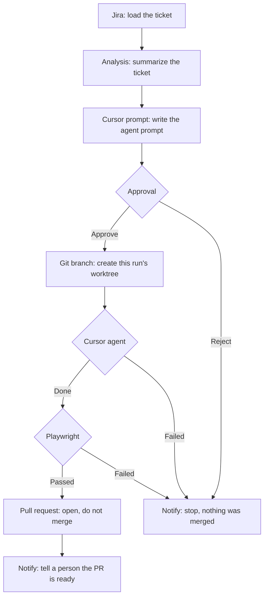

A person approves the prompt **before** any code is written. A second person merges the pull request on GitHub. The app opens that pull request and does not merge it.

Publish accepts the diagram only when the rules in the checklist below are true. A run then succeeds only when the worker machine has the accounts, paths, and environment variables for every step you included.

## Checklist

Use this before you press **Publish workflow**, and again before you point Jira at the webhook.

**Diagram**

- The workflow has a name.
- There is at least one step, and exactly one step has nothing connected into it. That step is the start. In the ticket workflow, Jira is the start.
- Every line connects two steps that are still on the board.
- The diagram has no loop back to an earlier step.
- Approval has two outgoing lines: **Approve** (true) into Git branch, and **Reject** (false) into a stop step.
- Cursor agent has two outgoing lines: **Done** (true) into Playwright, and **Failed** (false) into a stop step.
- Playwright has two outgoing lines: **Passed** (true) into Pull request, and **Failed** (false) into a stop step.
- Pull request is reached only by Playwright's **Passed** line. No other path leads to it.
- Condition steps that split also have one true line and one false line.
- Step settings do not contain a token. A value that looks like `Bearer …`, `ghp_…`, `ATATT…`, or `cursor_…` is rejected. Put secrets in the worker environment.

**Repository fields on the workflow**

These are required when the diagram contains Git branch, Cursor agent, Playwright, or Pull request.

- **Repository location** is a folder on the workflow worker that is already a checkout of the app. Example: `C:\repos\your-app`. A URL is not enough unless that same checkout is also available as `GIT_REPO_PATH` on the worker.
- **Default branch** is the branch new worktrees start from, usually `main`.
- **Credential reference** is the *name* of an environment variable, usually `GITHUB_TOKEN`. The token itself stays in the worker environment.

**Playwright step**

- **Where the tests live** is set. There is no default.
  - **Use the application repository** also needs a **Test path**, such as `e2e`.
  - **Use a separate Playwright repository** also needs that repo's location, default branch, and a test command with one argument per line.
- **Application under test** is set.
  - **Boot this run's worktree** also needs an **App command** (one argument per line, for example `npm` then `start`) and a **Readiness path** such as `/health`.
  - **Deployed preview** has no preview adapter in this workspace, so a run that selects it stops. Use **Boot this run's worktree** until a preview adapter exists.
- The test project contains exactly one of `pnpm-lock.yaml`, `package-lock.json`, or `yarn.lock`.

**Worker machine, for a ticket run**

| Needed for | Set this |
|---|---|
| The app itself | Node.js 18+, MongoDB (`MONGODB_URI`), Redis, `JWT_SECRET` |
| API and the main worker | `npm run dev` in the project root |
| Jira | `JIRA_BASE_URL`, `JIRA_EMAIL`, `JIRA_API_TOKEN`, `JIRA_WEBHOOK_SECRET` |
| Analysis | `ANALYSIS_BASE_URL`, `ANALYSIS_API_KEY`, `ANALYSIS_MODEL` |
| Git worktrees | Git on the PATH, `WORKTREES_DIR` pointing at an existing folder that is not inside the main checkout |
| GitHub | `GITHUB_TOKEN` (the value named by the credential reference), `GITHUB_OWNER`, `GITHUB_REPO` |
| Cursor agent | `CURSOR_API_KEY`, Docker, and `npm run worker:agent` |
| Playwright | `PLAYWRIGHT_IMAGE`, Docker, and `npm run worker:playwright` |
| Slack notify | `SLACK_WEBHOOK_URL` |

`npm run dev` runs the API and the main workflow worker. The Cursor agent and Playwright each run in their own process, because those environments are stripped of the workflow secrets.

## 1. Create an account

Open the app and choose **Create account**. The password needs at least 8 characters. After that you land on your workflow list.

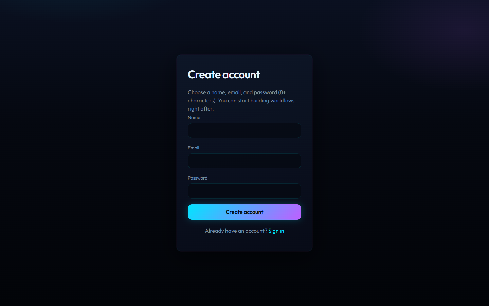

Later visits use **Sign in**.

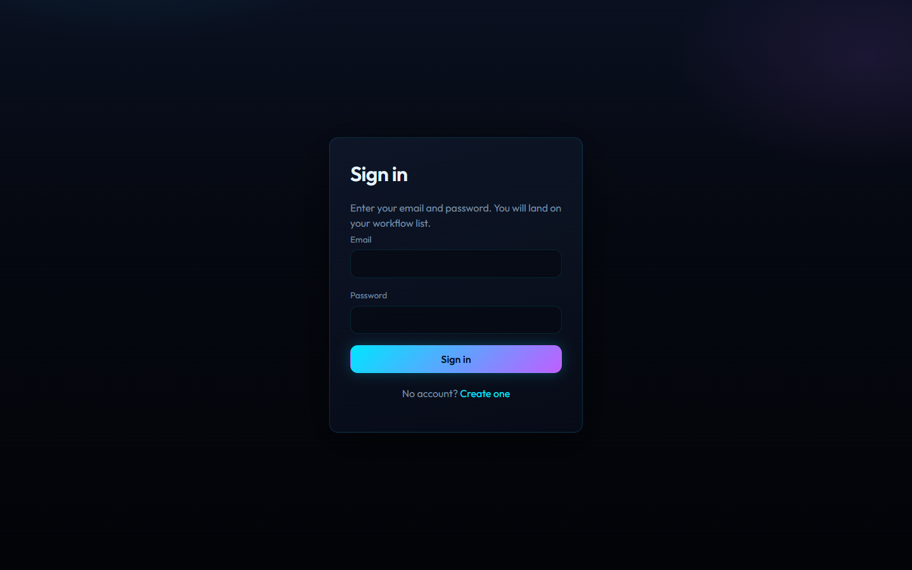

Each workflow and its runs belong to the account that created them. Another account cannot approve your run.

## 2. Create a workflow

An empty account shows three steps: create a workflow, connect the steps, then save and publish.

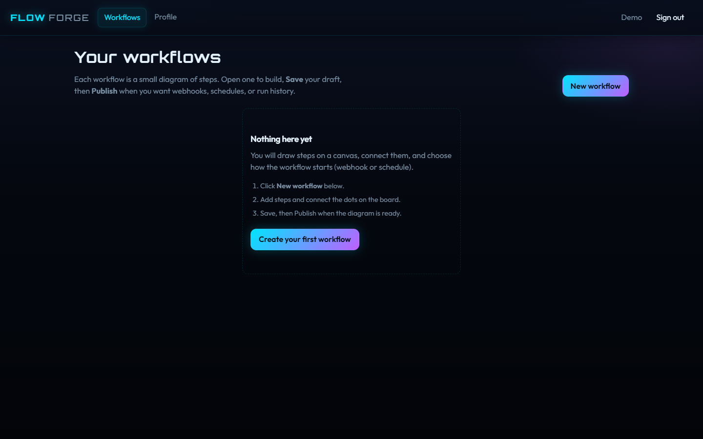

**New workflow** opens the editor on a draft named "Untitled workflow". Rename it in the editor. The list then shows the name, draft or published, the trigger, and how many steps it has. **Runs** opens the history. **Delete** removes the workflow.

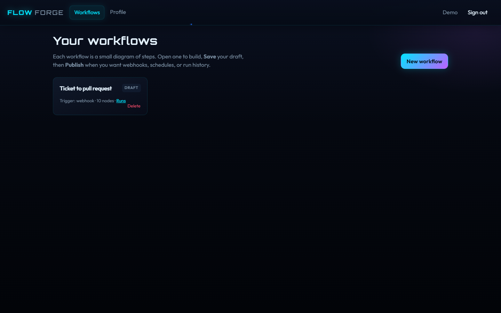

## 3. Name it and choose how a run starts

The left panel is the order of work. The board on the right is the diagram.

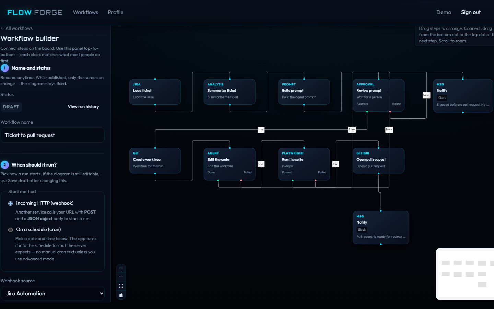

**Workflow name.** Use a name you will recognize in the list, such as `Ticket to pull request`. You can rename a published workflow. You cannot rewire its steps.

**When should it run?**

For the ticket workflow, choose **Incoming HTTP (webhook)** and set **Webhook source** to **Jira Automation**.

Jira Automation should `POST` JSON with:

- `issueKey`, shaped like `APP-42`
- `eventId`, a unique id of letters, numbers, `_`, or `-`, up to 128 characters

The request header `X-Webhook-Secret` must match `JIRA_WEBHOOK_SECRET` on the server. The shared-secret box on the workflow is for a generic webhook. Jira uses the environment variable, so the token is not stored on the workflow.

A generic webhook can use that shared-secret box. Callers then send the same value in `X-Webhook-Secret`. The JSON object you post becomes the input of the first step.

**On a schedule (cron)** runs the workflow from the clock instead. Pick every day or every year, or turn on **Custom cron expression** for a five-field cron string. The worker uses the server's time zone. **Enable this schedule** must be on or the schedule stays paused. Save the draft after you change the trigger.

## 4. Set the application repository

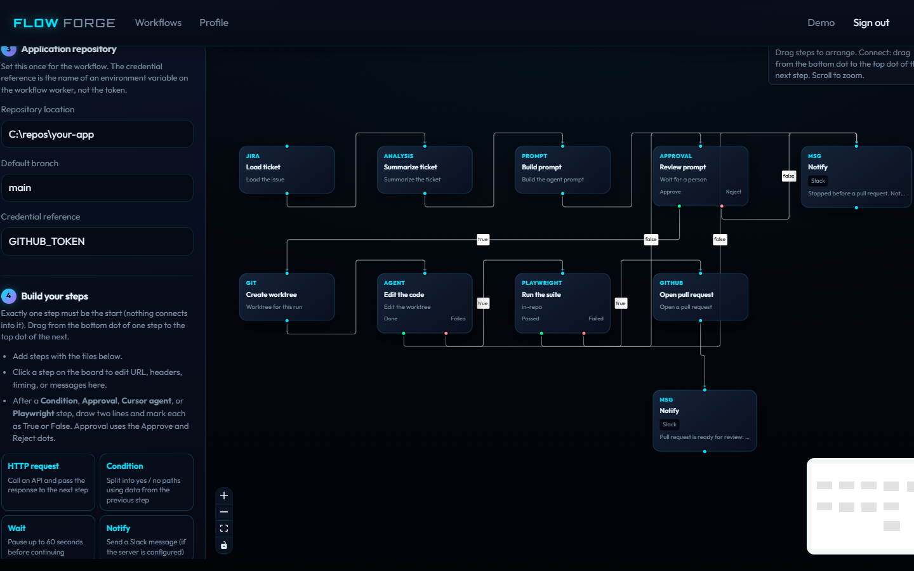

Fill this in once for the workflow.

| Field | What to enter |
|---|---|
| Repository location | Folder the worker can read, for example `C:\repos\your-app` |
| Default branch | `main`, or whatever branch new worktrees should start from |
| Credential reference | `GITHUB_TOKEN` |

The credential reference is a variable name. The worker reads `process.env.GITHUB_TOKEN` when it pushes the branch and opens the pull request. Pasting the token into this box makes publish fail, and it would also store the secret on the workflow.

## 5. Add the steps and connect them

Scroll to **Build your steps**. Each tile adds a step to the board. Click a step to edit it in **Step details** at the bottom of the left panel. Drag from the bottom dot of one step to the top dot of the next.

Arrange the ticket workflow in this order:

| Step | What it does | What you set on the step |
|---|---|---|
| Jira issue | Loads summary, description, and status | Title only. The ticket comes from the webhook. |
| Analysis | Summarizes the ticket. It does not edit the repo. | Title only. The model and key are `ANALYSIS_MODEL` and `ANALYSIS_API_KEY`. |
| Cursor prompt | Builds the prompt the approval screen will show | Title only. |
| Approval | Pauses until you approve or reject | Title is a label. Connect **Approve** and **Reject**. |
| Git branch | Creates a branch and a worktree used only by this run | Title only. The repo fields from step 4 are required. |
| Cursor agent | Edits that worktree | Title only. **Done** continues. **Failed** stops. |
| Playwright | Runs the suite against the revision the agent produced | See the next section. **Passed** continues. **Failed** stops. |
| Pull request | Opens a GitHub pull request | Title only. Connect it only from Playwright **Passed**. |
| Notify | Sends Slack a message, including `{{prUrl}}` on the success path | The message. The server needs `SLACK_WEBHOOK_URL`. |

Two runs of the same ticket do not share a branch or a worktree. The agent never receives the main checkout.

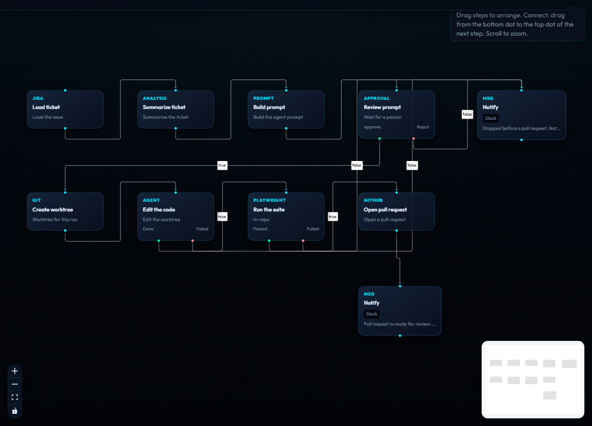

Lines that leave Approval, Cursor agent, or Playwright are marked **true** or **false**. You can also click a line and set **Meaning of this line**. Approve, Done, and Passed are true. Reject, Failed, and Failed tests are false.

**Save draft** stores the name, the trigger, the repository, and the diagram. Publish also saves first, then checks the diagram.

## 6. Fill in the Playwright step

Click the Playwright step. **Step details** is the only step in this lifecycle that needs more than a title.

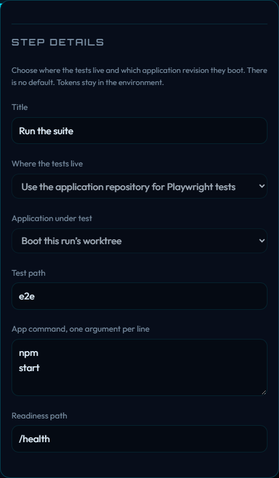

The screenshot is a published workflow, so the fields are locked. Set them while the workflow is still a draft:

- **Title:** `Run the suite`
- **Where the tests live:** Use the application repository for Playwright tests
- **Application under test:** Boot this run's worktree
- **Test path:** `e2e` (the folder or file in that repo)
- **App command:** one argument per line, `npm` then `start`
- **Readiness path:** `/health`

The worker starts the app from this run's worktree, waits until that path responds, runs the tests against that process, and records the git revision that was tested. The pull request opens only when that result is a pass for this run and that same revision.

## 7. Publish

**Publish workflow** saves the draft, checks the checklist above, and locks the board. A yellow **Fix the diagram** box means a split is missing a true or false line. The error under the header is the check that failed. Fix that, save, and publish again.

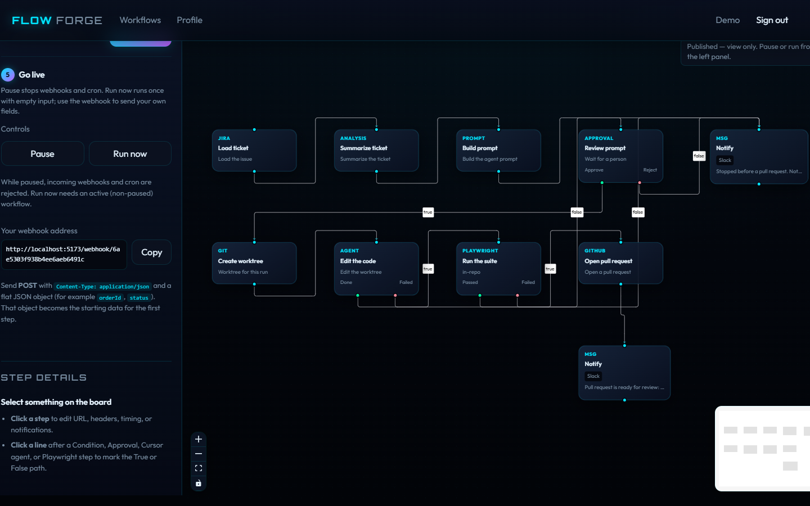

After publish you get:

- **Pause** and **Resume.** While paused, webhooks and cron are rejected.
- **Run now.** Starts one run with an empty input. Resume the workflow first if it is paused. A Jira workflow needs `issueKey`, so start that one from the webhook rather than **Run now**.
- **Your webhook address.** `POST` this URL. For Jira it looks like `http://localhost:5173/webhook/<workflow id>` when the UI is proxied to the API. Copy it into the Jira Automation rule, and send `X-Webhook-Secret`.

The same `issueKey` and `eventId` posted again does not start a second run.

## 8. Watch the run and approve it

**View run history** lists every execution. A run that has reached Approval stays on **waiting** until you decide.

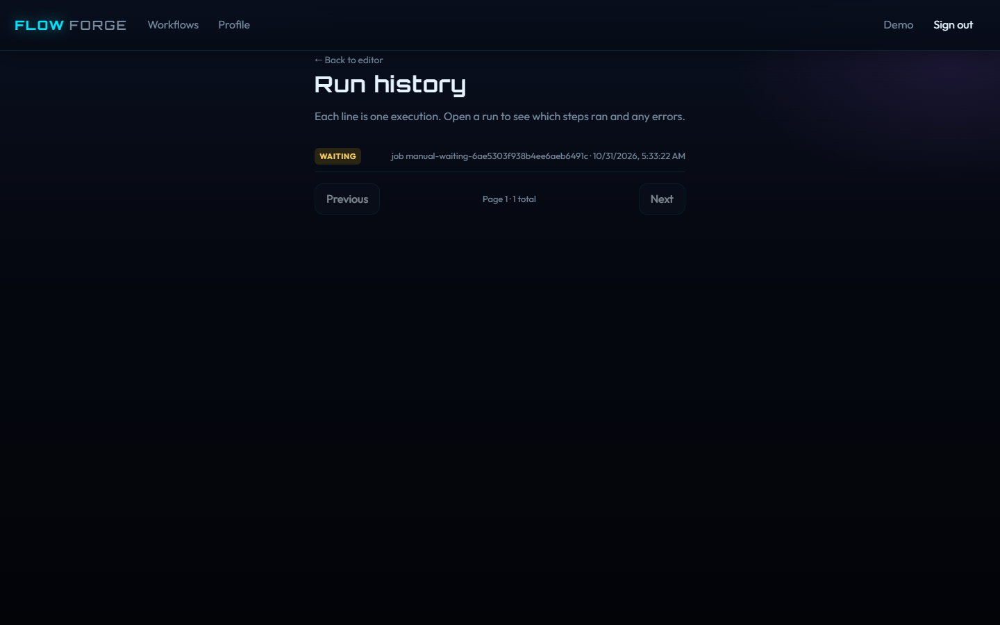

Open the run. The approval panel shows the prompt the Cursor prompt step built. **Approve** continues into Git branch. **Reject** follows the false line. Only the workflow owner can decide. A second click does not decide again.

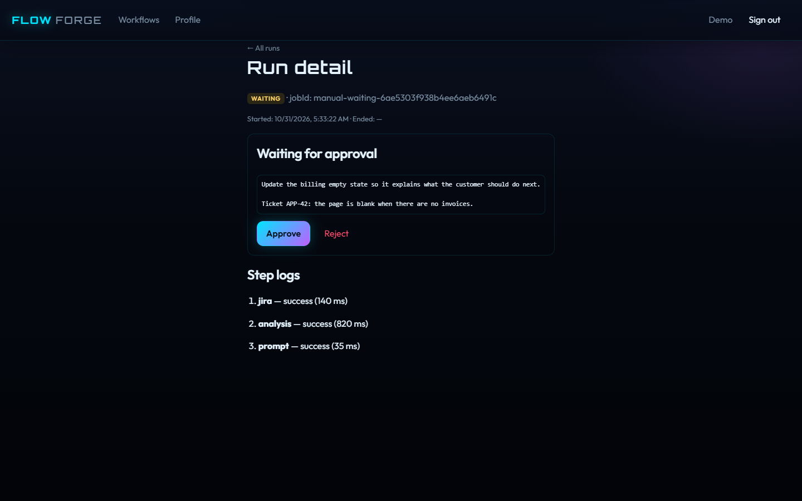

The page refreshes while a later step is waiting on the Cursor agent or on Playwright. When the pull request step finishes, the run detail shows the pull request link. Merge that pull request yourself on GitHub. Nothing in this app merges it.

Step logs show which node ran, how long it took, and the error when a step fails.

## Steps you can use outside the ticket flow

The same editor can publish a smaller diagram. It still needs one start step, no loops, and a real true/false pair when a condition or approval splits.

| Step | Use it for |
|---|---|
| HTTP request | Call an API. Set the method, URL, headers, and body. Click **Apply headers & body** before you save. |
| Condition | Read a field from the previous step, such as `user.id`. Operators are "has a true value", "field exists", and "equals a value". |
| Wait | Pause up to 60 seconds, then continue with the same data. |
| Notify | Slack message. `{{field}}` inserts a value from the previous step. |
| Approval | Pause for a person even when the rest of the diagram is not the ticket flow. |

A perfect small workflow is still specific: one start, every required field filled, secrets only in the environment, and both sides of every split connected to the step that should actually run.
