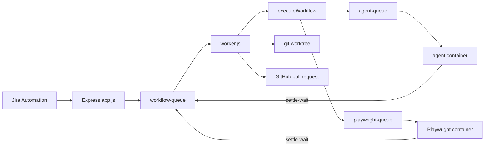

# Workflow Builder Implementation

Build plan for the lifecycle in `architecture.md`:

**Jira → AI analysis → Cursor prompt → human approval → Git branch/worktree → Cursor agent → Playwright → GitHub pull request (execution completes) → human merge.**

`architecture.md` stays the audit of the current engine and the contract for the Phase 1 lease. Section 15 of that file is the revision contract. This file is the order of work and the library choices, and it uses the same names. Re-read the source file named in a step before editing it. If the source and either document disagree, the source wins until that step deliberately changes it. Where this file and section 15 of `architecture.md` disagree, section 15 wins.

Phases still close only when the acceptance tests in `architecture.md` section 14 pass. Phase 3 does not start while Phase 1 or Phase 2 is open.

## Decisions

These replace weaker options that were in the first audit. `architecture.md` is updated to match.

| Area | Use | Why |
|---|---|---|
| Cursor | `@cursor/sdk` local `Agent.create` inside the agent container | The SDK is the supported way to run a Cursor agent from this app. `Agent.create` plus `send` exposes the agent id and run id before the run finishes, which `Agent.prompt` does not. Local `cwd` is this run’s worktree. A cloud agent clones its own repo and can open a pull request itself, which skips both gates. Docs: [TypeScript SDK](https://cursor.com/docs/sdk/typescript). |
| Cursor package shape | ESM worker and `scripts/agent-sandbox-entry.mjs`, not a `require` from `app.js` | This API is CommonJS. `@cursor/sdk` is ESM. `app.js` never loads either file. The host worker starts the container. The entry inside the container calls the SDK. |
| Agent and Playwright completion | The external worker enqueues `settle-wait` on `workflow-queue` | Both workers already talk to Redis. They do not write MongoDB and they do not call the API. `settleWait` performs the atomic completion and then enqueues `resume-workflow`. An HTTP callback would add a public route and a per-run secret for a process we own. |
| Playwright | Explicit `in-repo` or `external-repo` strategy, plus explicit `config.target` | The editor asks “Use the application repository for Playwright tests” or “Use a separate Playwright repository”. There is no strategy default. `config.target` is `local-worktree` or `deployed-preview`, also with no default, and it is independent of strategy. This repo does not take a Playwright dependency. |
| Functional repository | Workflow location, default branch, and credential references | The user sets these once while creating or editing the workflow. The reference is an environment-variable name. The token stays in the worker environment and is never sent to the agent. |
| Git | `child_process.spawn("git", args, { shell: false })` | Argument arrays keep issue keys and branch names out of a shell. `simple-git` is an extra dependency with a history of shell surprises. |
| GitHub | `@octokit/rest` | Official client. The service exposes `openPullRequest` and has no merge function. |
| Jira | `axios` to [Jira REST API v3](https://developer.atlassian.com/cloud/jira/platform/rest/v3/intro/) | Already in the repo. A Jira SDK does not earn its weight for one GET and one webhook check. |
| Jira ingress | Existing webhook plus a shared secret | Jira Automation can POST the issue key and a secret header. An Atlassian Connect app is a second product. |
| Analysis | OpenAI-compatible chat completions, JSON checked with `zod` | Analysis runs before approval and must not be able to edit a repo. A Cursor agent can edit files, so it is the wrong tool for this step. |
| Secrets | Environment variables | One owner. A Mongo integration vault needs encryption and a read path that cannot leak into `GET /workflow/:id`. |
| HTTP node | Timeout only | An allowlist would break published workflows that call arbitrary URLs. Jira, GitHub, analysis, and Cursor use their own clients and fixed hosts. |
| Prompts | New helper, separate from `interpolateMessage` | `interpolateMessage` slices objects to 200 characters for Slack. A prompt built that way is truncated. |
| Wait | Return `{ control: "wait", kind, output }` | A throw is retried by `executeWithRetry` and then by BullMQ, which collides on `Run.jobId`. |
| Tests | `node --test --test-concurrency=1` | Node’s test runner is enough. Concurrency 1 keeps the lease timing tests from sharing one Mongo clock. |
| Linux paths | Fix `require` strings in Phase 1 | The filenames on disk are already lowercase. Renaming them on Windows does not stick in Git. |

Unchanged, and still binding:

- One walker: `executeWorkflow`. BullMQ and Redis stay.
- Phase 1 lease on the `Run` row, renewed on MongoDB `$$NOW`, as written in `architecture.md` section 13 refinement 2 and section 14.
- Human approval is `status: "waiting"`, not a Slack message.
- One application worktree per run. Concurrent runs of the same Jira issue do not share a branch or a worktree. The agent never receives the main checkout.
- A pull request is opened only after the Playwright gate in `architecture.md` section 15 item 11 passes, including a pass for this run and the tested revision. Nothing in this repo merges it.
- Condition nodes still return a boolean. Existing graphs keep working.

## Target runtime



Local development keeps the API and `worker.js` in one process, as `npm run dev` does today. The agent worker and the Playwright worker are extra processes even locally, because their environments are stripped. Production splits the API and the workflow worker as well. Only the API process runs `node-cron`.

## Dependencies

Add a package only in the phase that imports it.

| Phase | Add | Leave out |
|---|---|---|
| 1 | nothing | Jest, Vitest, `mongodb-memory-server`, `simple-git` |
| 2 | nothing | socket servers, a second queue |
| 3 | `@cursor/sdk`, `@octokit/rest`, `zod` | a Jira SDK, Playwright, an `Integration` model |

`axios`, `bullmq`, `mongoose`, and `uuid` are already dependencies. Git is a binary on the workflow worker. The Playwright CLI and browsers live in the pinned Playwright image, not in this repository and not assumed to be inside the application worktree. They are not npm dependencies of this project.

`npm test` becomes `node --test --test-concurrency=1`. Tests live in `test/` and load the real MongoDB named in `MONGODB_URI`. The database name must end in `_test`. The suite refuses to start otherwise, so it cannot wipe the development database. Redis is required only for worker-level tests. Engine tests call `executeWorkflow` directly.

Phase 1 tests are the bullets in `architecture.md` section 14. Copy them as the spec. They must fail on today’s code and pass after the fix. Do not weaken the lease-lifetime sequence.

## Phase 1 — Reliability

Files to re-read first: `src/services/executionengine.js`, `src/models/Run.js`, `src/workers/worker.js`, `src/services/queue.js`, `src/utils/workflowGraph.js`, `config/index.js`, `node_modules/bullmq/package.json`. The BullMQ version this plan was checked against is 5.74.1.

### 1. Require paths

Point every `require` at the filename on disk:

| Call site | Current string | File on disk |
|---|---|---|
| `app.js` | `./src/routes/WorkflowRoutes` | `src/routes/workflowRoutes.js` |
| `src/workers/worker.js` | `../services/executionEngine` | `src/services/executionengine.js` |
| `src/routes/workflowRoutes.js` | `../controllers/WorkflowController` | `src/controllers/workflowController.js` |
| `src/services/executionengine.js`, `src/controllers/workflowController.js`, `src/controllers/RunController.js`, `src/services/schedulerService.js`, `src/services/triggerService.js` | `../models/Workflow` | `src/models/workflow.js` |

### 2. Config parsing

In `config/index.js`:

- `parsePositiveInt` accepts a base-10 integer greater than zero. `0`, negatives, blanks, non-integers, and other malformed strings use the fallback.
- `HTTP_TIMEOUT_MS` falls back to 15000.
- `WORKER_LOCK_DURATION_MS` falls back to 30000.
- `EXECUTION_CLAIM_LEASE_MS` falls back to 30000.

Export `parsePositiveInt`, `httpTimeoutMs`, `workerLockDurationMs`, and `executionClaimLeaseMs`.

### 3. `Run` fields

Add, without adding `waiting` yet:

| Field | Role |
|---|---|
| `currentNodeId` | Node about to run |
| `context` | Full payload, capped at 256 KiB of BSON. Logs stay a 200-character preview and cannot rebuild this |
| `executionClaim` | Token of the attempt that owns the row |
| `executionClaimExpiresAt` | `$$NOW` plus the lease |

`jobId` stays unique. A repeated BullMQ `job.id` loads the existing row. It does not call `Run.create` again.

### 4. Claim, renew, persist

Implement the six rules in `architecture.md` section 13 refinement 2. Names to export from `executionengine.js` so the tests can call them:

- `acquireExecutionClaim`
- `renewExecutionClaim`
- `persistRun`
- `buildExecutionClaimRenewEveryMs`

Clock is MongoDB `$$NOW` inside one aggregation-pipeline `findOneAndUpdate`. Workers do not compare lease time with `Date.now()`.

`persistRun` is the only writer of `logs`, `context`, `currentNodeId`, and `status` after the row exists. `Document#save()` stops being the writer for those four fields. A null return means this attempt lost the row. The walker then throws `RUN_CLAIM_BUSY` and does not write again.

`buildExecutionClaimRenewEveryMs` returns `Math.floor(leaseMs / 2)` and throws unless that value is a positive integer strictly below `leaseMs`.

### 5. Walker

`executeWorkflow(workflowId, inputData, jobId)`:

1. Resolve the job id as it does now.
2. Load `Run` by `jobId`. Create it only when missing, with `status: "running"` and `logs: []`.
3. A `success` row returns without calling a node.
4. A row with no `currentNodeId` and status `running` or `failed` starts at the indegree-0 node with the job input. Truncated logs are not a cursor.
5. `acquireExecutionClaim` before the first node. `renewExecutionClaim` before every later node. A null renew means `executeNode` is not called.
6. `persistRun` the cursor, start the renew timer, call `executeWithRetry`, clear the timer, `persistRun` the result.
7. The renew timer’s first fire is after half the lease, not at the deadline. One timer covers every internal retry of that node. If renew returns null, stop the timer, let the in-flight call settle, discard its result, skip `persistRun`, and throw `RUN_CLAIM_BUSY`. If renew throws, wait one interval and try once more.
8. HTTP keeps `method`, `url`, `headers`, and `body`, and gains `timeout: config.httpTimeoutMs`.
9. Condition, delay, and notify behavior stay as they are. Delay remains an in-process sleep of 0–60 seconds.

`getNextNode`:

- A boolean result still selects `condition: "true"` or `"false"`.
- One outgoing edge still follows that edge for any result.
- An object with two outgoing edges selects on `result.branch === "true"` or `"false"`. Any other object throws. This stops a later approval payload from falling through to the false edge.

### 6. Worker lock

`buildWorkflowWorkerOptions(lockDurationMs)` returns `{ connection, concurrency: 1, lockDuration, lockRenewTime }` with `lockRenewTime = Math.floor(lockDuration / 2)`. It throws when that half is not a positive integer below `lockDuration`. BullMQ 5.74.1 treats `lockRenewTime: 0` as unset and would otherwise fall through to its own default.

`handleWorkflowJob(job)` reads `workflowId` and `input` from `job.data` and calls `executeWorkflow(..., String(job.id))`. On `RUN_CLAIM_BUSY` it calls `job.moveToDelayed` and throws BullMQ’s `DelayedError`. `src/workers/worker.js` uses this function.

Do not raise `lockDuration` to cover the whole graph. A live process renews. A dead process must become reclaimable.

### 7. Cycles

`validateWorkflowGraph` walks every node, including nodes the start node cannot reach. `S → A → B → A` is rejected. `S → A` plus a disconnected `B → C → B` is rejected with the same message. A line and a true/false split are accepted. Use a recursion stack, not only “reachable from the start”.

### 8. Phase 1 is done when

Every Phase 1 bullet in `architecture.md` section 14 passes, including lease lifetime, live HTTP timeout, disconnected cycles, config parsing, and old `Run` rows. `npm test` is that command.

## Phase 2 — Human approval

Re-read `src/controllers/RunController.js`, `src/services/executionengine.js`, `src/models/workflow.js`, `frontend/src/pages/WorkflowRunDetail.jsx`, and `frontend/src/pages/WorkflowRuns.jsx`.

### Wait contract

A node that must pause returns:

```javascript
{ control: "wait", kind: "approval", output: input }
```

`executeWithRetry` returns that object as-is. It does not retry it and it does not throw. `executeWorkflow` then calls `persistWaitingRun`, not Phase 1 `persistRun`. The filter still requires this attempt’s claim token and `executionClaimExpiresAt > $$NOW`. The update writes `status: "waiting"`, `currentNodeId`, `context`, and the `wait` fields from `architecture.md` section 15 item 1, and it sets `executionClaim` and `executionClaimExpiresAt` to null. The renewal timer is cleared. The function returns. The BullMQ job completes. If that job is redelivered while `status` is still `waiting`, `executeWorkflow` returns without acquiring the claim and without walking. Only `beginResume` may leave `waiting`. A throw on an intentional wait is a bug: BullMQ would rerun the job and hit the unique `jobId`.

`Run.status` enum gains `waiting`. Phase 1 `persistRun` does not clear the claim. A stale token cannot release it.

### Resume job

`enqueueWorkflowJob` grows a payload of `{ workflowId, input, runId, startNodeId }` and a caller-supplied `jobId`. Resume ids use hyphens, never `:`. BullMQ uses `:` inside Redis keys, so a custom id that contains `:` is rejected. Ids are not made safe by deleting characters.

Approval resume id: `resume-approval-<runId>-<nodeId>`.

`settleWait` writes the completion and `pendingResume.enqueuedAt: null` in one update, then enqueues that id, then stamps `enqueuedAt`. `enqueuePendingResumes` retries the enqueue when the process dies between those steps. `beginResume` is the conditional update that moves `completing` to `resumed`. A second resume job returns without walking. The saved `context` is the payload. The graph does not restart at the first node.

### Decision route

`POST /runs/:runId/decision` with `{ decision: "approved" | "rejected" }`.

- Caller must be `Workflow.userId`, the same check as `getRunById`. Anyone else gets 403. The row stays `waiting`. Nothing is enqueued.
- `recordDecision` calls `settleWait`. The update matches only a `waiting` run whose `wait.kind` is `approval`, whose `wait.state` is `pending`, and whose `approval.decision` is absent. It sets the decision, the user, `decidedAt`, and `context.branch` in that same update.
- The request that wins the update enqueues the resume job. Every other request, including a repeat, returns HTTP 409 and does not enqueue.
- If the update won and `queue.add` throws, the response is HTTP 503. The decision stays. The reconciler enqueues the one resume.

The approval node, on resume, returns `{ ...context, branch }`. `getNextNode` follows the existing edge labels. Reject does not create a worktree, enqueue `agent-queue`, or open a pull request. There is no worktree code in this phase; the rejection test asserts those side effects are absent by asserting the false-edge node ran and the true-edge node did not.

Notify may Slack the reviewer. Delivery is not an acceptance test.

### Editor and run pages

| File | Change |
|---|---|
| `frontend/src/lib/workflowCanvas.js` | `defaultConfigForType("approval")` and a label. Config holds a display title only |
| `frontend/src/pages/WorkflowEditor.jsx` | Palette button, `nodeTypes`, inspector |
| `frontend/src/components/nodes/ApprovalNode.jsx` | Same Handle pattern as `HttpNode.jsx`, with true and false source handles |
| `frontend/src/lib/api.js` | `decideRun(runId, decision)` |
| `frontend/src/pages/WorkflowRunDetail.jsx` | When `status === "waiting"`, show the prompt text and Approve / Reject. Refetch every 3 seconds while waiting |
| `frontend/src/pages/WorkflowRuns.jsx` | Show `waiting`. Refetch every 3 seconds while any visible row is waiting |
| `frontend/vite.config.js` | Proxy `/runs` |

Every workflow JSON response goes through `redactWorkflowForResponse`: create, list, get, update, replace, publish, and trigger-enabled. Run list and run detail use the same walker on `context`, `logs`, `wait.completion`, and `external`. `trigger.config.secret` is omitted and `trigger.config.secretSet` is a boolean. HTTP `Authorization`, `X-Api-Key`, and the other secret-like fields in `architecture.md` section 15 item 8 are omitted, with `config.secretSet` recording that they were set. An update that omits a secret whose indicator is true keeps the stored value.

### Phase 2 is done when

Every Phase 2 bullet in `architecture.md` section 14 passes. That includes the original approval, rejection, and unauthorized-decision tests, and the race, repeated-decision, immediate-resume, duplicate-completion, crash-before-enqueue, two-approval-node, and credential-redaction tests. Writing those tests does not mark the phase complete.

## Phase 3 — Lifecycle

Start only after Phase 1 and Phase 2 are closed. Each node merges its result into the payload (`{ ...input, jira }` and so on) so a condition node earlier in the graph is the only step that replaces the payload with a boolean.

Publish-time checks in `validateWorkflowGraph`, added with the node that needs them:

- Condition and approval splits have one `true` edge and one `false` edge.
- Node `config` is rejected when a value looks like a token (`Bearer `, `ghp_`, `ATATT`, `cursor_`). Placeholders and URLs the user typed for the HTTP node stay legal.
- `githubPr` is unreachable once every Playwright `true` edge is removed from a copy of the graph. A direct edge from any other node is also rejected. The runtime check in section 15 item 11 of `architecture.md` still runs.

### Shared job rules

| Queue | Attempts | What a retry repeats |
|---|---|---|
| `workflow-queue` | 3, existing backoff | The workflow job. Checkpoints skip nodes whose success was saved |
| `agent-queue` | 2 | A retryable startup failure on a tree still clean at `preAgentSha`. A dirty or already-committed tree does not start another agent |
| `playwright-queue` | 1 | Nothing automatic. A failed, timed-out, or bootstrap-failed suite takes the false edge |

`removeOnComplete: { count: 1000 }` and `removeOnFail: false` match the workflow queue.

Wait kinds `agent` and `playwright` use the same `persistWaitingRun` and `settleWait` path as approval. Resume ids:

- `resume-agent-<runId>-<nodeId>`
- `resume-playwright-<runId>-<nodeId>`

The external worker enqueues `settle-<kind>-<runId>-<nodeId>`. It does not enqueue resume itself and it does not write MongoDB. Duplicate, late, and out-of-order completions are rejected by the conditional update in `architecture.md` section 15 item 1. BullMQ retention is not the lock.

`context` stored for these waits includes the prompt or the Playwright summary, still under the 256 KiB cap. Step logs store a short preview, not the full diff.

### Environment

| Variable | Process | Purpose |
|---|---|---|
| `JIRA_BASE_URL` | workflow worker | Site origin, for example `https://your-site.atlassian.net` |
| `JIRA_EMAIL`, `JIRA_API_TOKEN` | workflow worker | Basic auth for REST API v3. [API tokens](https://support.atlassian.com/atlassian-account/docs/manage-api-tokens-for-your-atlassian-account/) |
| `JIRA_WEBHOOK_SECRET` | API | SHA-256 digests of the header and this value are compared with `crypto.timingSafeEqual` |
| `ANALYSIS_BASE_URL` | workflow worker | OpenAI-compatible origin |
| `ANALYSIS_API_KEY`, `ANALYSIS_MODEL` | workflow worker | Chat call. The model id comes from the account, not from this document |
| `GIT_REPO_PATH` | workflow worker | Fallback only when the workflow’s functional-repository location is a worker-accessible path that still has to be resolved. The user-facing value is the workflow configuration, not a hardcoded path |
| `GIT_BASE_BRANCH` | workflow worker | Default branch from the workflow configuration. New ticket branches start from that revision |
| `WORKTREES_DIR` | workflow worker | Parent of per-run application worktrees, outside the main checkout. The agent container receives only one worktree mount, not this parent |
| `GITHUB_TOKEN`, `GITHUB_OWNER`, `GITHUB_REPO` | workflow worker | Pull request and the push child’s `GIT_ASKPASS_TOKEN`. Absent from agent and Playwright containers |
| `CURSOR_API_KEY` | agent container | Passed as the SDK `apiKey` only. Not written into the worktree. [Create a key](https://cursor.com/dashboard/integrations) |
| `CURSOR_MODEL` | agent container | Optional. Default `composer-2.5`. Local runs require a model |
| `CURSOR_EGRESS_HOSTS` | agent worker | Comma-separated HTTPS hosts the container may call. Empty fails the job. Hostnames come from the current SDK docs and are not listed here |
| `AGENT_RUNTIME` | agent worker | OCI CLI. Default `docker`. No host fallback |
| `AGENT_TIMEOUT_MS` | agent worker | Kill the named container. Fallback 1800000 via `parsePositiveInt` |
| `AGENT_MEMORY`, `AGENT_CPUS`, `AGENT_PIDS` | agent worker | Container resource limits |
| `PLAYWRIGHT_REPO_PATH`, `PLAYWRIGHT_REPO_REVISION` | Playwright worker | Separate test repository for `external-repo`. Unused by `in-repo` |
| `PLAYWRIGHT_WORKTREES_DIR` | Playwright worker | Parent of per-run test worktrees |
| `PLAYWRIGHT_IMAGE` | Playwright worker | Image pinned by digest. Browsers come from this image |
| `PLAYWRIGHT_ARGS` | Playwright worker | JSON array of CLI args, default `["test"]` |
| `PLAYWRIGHT_TIMEOUT_MS` | Playwright worker | Kill the container. Fallback 600000 via `parsePositiveInt` |
| `PLAYWRIGHT_ENV_ALLOW` | Playwright worker | Comma-separated names copied into the container. Empty means only `PATH`, `CI=1`, `BASE_URL`, and `GIT_COMMIT` |
| `PLAYWRIGHT_BROWSERS_PATH`, `PLAYWRIGHT_CACHE_DIR`, `PLAYWRIGHT_ARTIFACTS_DIR` | Playwright worker | Browser cache, package cache, and reports. Not the developer home |
| `PLAYWRIGHT_MEMORY`, `PLAYWRIGHT_CPUS` | Playwright worker | Container resource limits |
| `SCHEDULER_ENABLED` | API | `true` on the API process, `false` on every worker |
| `WORKFLOW_WORKER_ENABLED` | API | `false` once the workflow worker is its own process |

### Jira

`trigger.type` stays `webhook | cron`. Jira Automation sends:

`POST /webhook/:workflowId` with header `x-webhook-secret` and JSON `{ "issueKey": "PROJ-1", "issueId": "10001", "eventId": "20002" }`.

This shape applies when `trigger.config.provider` is `"jira"`. `issueId` in the body is optional and is only a check. The canonical id is the `id` returned by Jira. `eventId` is required and must already match `^[A-Za-z0-9_-]{1,128}$`. Characters are not stripped. A missing or illegal `eventId`, a bad issue key, or an `issueId` that disagrees with Jira is HTTP 400 and does not enqueue. A bad secret is HTTP 401 and does not enqueue.

The BullMQ job id is `jira_<issueId>_<eventId>` using the id Jira returned. The same pair is one run. A different `eventId` for the same issue is another run.

`jiraService.fetchIssue(issueKey)`:

- Rejects a key that is not `^[A-Z][A-Z0-9]+-\d+$` before any request.
- GET `{JIRA_BASE_URL}/rest/api/3/issue/{key}?fields=summary,description,status,issuetype`.
- Auth header is Basic, from `JIRA_EMAIL` and `JIRA_API_TOKEN`.
- Timeout uses `httpTimeoutMs`.
- Returns `{ id, key, summary, descriptionText, status }`. ADF descriptions are flattened to text in this function. The HTTP node is not involved.

The `jira` node returns `{ ...input, jira: issue }`.

### Analysis and prompt

`analysisService.analyzeIssue(issue)` POSTs to `{ANALYSIS_BASE_URL}/chat/completions` with `response_format` JSON object. The user message is the summary and the flattened description. The system message asks for:

```json
{ "summary": "", "risks": [], "filesLikelyTouched": [], "acceptanceChecks": [] }
```

`zod` parses that shape. A parse failure fails the node. The call has `httpTimeoutMs` and does not follow a URL stored in the graph.

`cursorPromptService.buildPrompt(issue, analysis)` returns one string. It concatenates fields in code and places the Jira summary and description in a delimited untrusted-data block. It does not call `interpolateMessage` and it does not build a shell command. Cap the string at 32 KiB. Ticket text cannot select a branch, a path, or a pull request.

The `cursorPrompt` node returns `{ ...input, prompt }`. The approval screen renders `context.prompt`.

### Approval in the lifecycle graph

The node from Phase 2 is the gate. Its `true` edge is `gitBranch`. Its `false` edge is a `notify` that says the ticket was rejected, or the end of the graph. Reject still creates nothing on disk.

### Git worktree

`gitService` follows `architecture.md` section 15 item 6. It spawns `git` with `shell: false` and an argument array. The branch is `wf/<issueKey>/<runId>`, or `wf/manual/<runId>` when there is no issue key. `git check-ref-format --branch` must accept it before any worktree command. A name taken from the ticket title is not used.

The worktree segment is `<runId>-<nodeId>`. `createWorktree` realpath-checks `WORKTREES_DIR`, rejects `..` and symlinks, and refuses a path that resolves outside that directory. Called twice for a ready worktree on the expected branch, it returns the same path and does not spawn a second `worktree add`. A crash during add or remove is repaired by the next create or by `reconcileWorktrees`.

The node stores `external.worktreePath`, `external.branch`, and `external.worktreeState` through the claim-holding checkpoint and returns the path and branch on the payload. `GIT_REPO_PATH` is never sent to the agent container.

`removeWorktree` runs when the pull request node finishes and when the run fails after a worktree exists. A failure to remove is logged and does not hide the original result. The reconciler retries a remove left in `removing`.

`pushBranch` pushes `<testedSha>:refs/heads/<branch>` with the restricted env in section 15 item 6. The token is only `GIT_ASKPASS_TOKEN` on that child.

### Cursor agent

`cursorAgentService.enqueueAgent` only adds a job. It does not import `@cursor/sdk`.

The workflow node calls `persistWaitingRun` first, including `external.agentExecutionId` and `external.preAgentSha`, releases the claim, and only then enqueues the agent job. Job data: `{ runId, workflowId, nodeId, prompt, worktreePath, externalJobId, agentExecutionId, preAgentSha }`. The node returns the wait control with `kind: "agent"`.

`agentWorker.mjs` holds Redis only. It does not connect to MongoDB. On each job it classifies the worktree as in `architecture.md` section 15 item 10. When a new attempt is allowed, it starts one container named `wf-agent-<agentExecutionId>` with the mounts, user, network, and limits in section 15 item 5. Scrubbing the host `process.env` remains defense in depth and is not the sandbox.

`scripts/agent-sandbox-entry.mjs` runs inside the container:

```javascript
import { Agent, CursorAgentError } from "@cursor/sdk";

const agent = await Agent.create({
  apiKey,
  model: { id: process.env.CURSOR_MODEL || "composer-2.5" },
  local: { cwd: "/worktree", settingSources: [] },
});
try {
  const run = await agent.send(prompt);
  // Write agent.agentId and run.id into /worktree/.workflow/agent-execution.json
  // before wait() returns.
  const result = await run.wait();
} finally {
  await agent[Symbol.asyncDispose]();
}
```

There is no `cloud` field. `settingSources: []` keeps user settings and MCP servers out of the run. It does not isolate the filesystem.

A retryable `CursorAgentError` while the tree is still clean at `preAgentSha` throws so BullMQ can use attempt 2. Any other outcome enqueues `settle-wait` and does not treat `result.status === "finished"` as success by itself. The workflow worker re-checks the commit before it accepts the settle. The prompt tells the agent to commit in the worktree and not to push. Push credentials exist only on the workflow worker.

`npm run worker:agent` is `node src/workers/agentWorker.mjs`.

### Playwright

`playwrightService.enqueueSuite` runs only after `external.testedSha` is recorded from a clean application worktree and the diff against `external.preAgentSha` is non-empty. The node waits with `kind: "playwright"`. `config.strategy` and `config.target` are both required. Publish rejects a missing or unknown value. There is no implicit default.

The functional repository, its default branch, and its credential references live on the workflow and are validated before publish. `in-repo` uses that repository and the node’s test path. `external-repo` also stores the Playwright repository location, default branch, and test command array. Those test-repository credentials are references, not values, and they are not passed to the Cursor Agent.

`config.target` `local-worktree` installs the functional worktree with that repository’s own lockfile and frozen-install command, starts `config.appCommand` as an argument array from that worktree, binds an isolated port, and waits for the configured readiness check. `deployed-preview` deploys that same tested SHA through the configured adapter or command array, then requires proof of the deployed SHA before the suite starts. A successful deploy without that proof does not pass. There is no fallback to a shared preview.

`playwrightWorker.js` starts the pinned image. It does not spawn the CLI on the host and it does not call a model. `in-repo` uses the application worktree as the test project. `external-repo` checks out the configured Playwright repository into its own worktree and installs it with that repository’s own lockfile. The application install, when local, uses the functional repository’s lockfile. The install and browser steps are separate from the test step. Their failure is `bootstrap-failed`. A timeout is `timed-out`. Exit 0 without a JSON report is not `passed`. A pass also requires the verified application SHA. The worker stops the local process, or cleans up the preview, after success, failure, and timeout.

The container env is the allowlist in section 15 item 7. The worker enqueues `settle-wait`. The workflow worker accepts a pass only when `git rev-parse HEAD` in the application worktree is still `external.testedSha`. Stdout and stderr saved on the run are capped at 32 KiB and redacted.

### Pull request

`githubPr` is reachable only through a Playwright `true` edge, on every path, as `validateWorkflowGraph` checks by deleting those edges. The node checks the predecessor’s `external.playwrightByNode` entry at runtime: `status` is `"passed"`, `reportPresent` is true, and `testedSha` equals `external.testedSha` and the current `HEAD`. A missing, failed, timed-out, or bootstrap status throws before GitHub is called. A pass for a different node or a different SHA throws as well.

Before opening a request, `gitService.pushBranch` pushes that tested SHA. The token is not placed in the argument list. The child receives it through `GIT_ASKPASS` and `GIT_ASKPASS_TOKEN`, with the rest of the child env restricted as in section 15 item 6.

`githubPrService.openPullRequest` uses `@octokit/rest` `pulls.create` against `api.github.com`. If a pull request for that head already exists, return its URL instead of creating another. There is no `pulls.merge` call in this file.

The node stores `external.prUrl` and returns `{ ...input, prUrl }`. The following `notify` node posts that URL. A person merges on GitHub.

On success or on a later failure of this run, remove the worktree.

### Suggested graph

1. `jira`
2. `analysis`
3. `cursorPrompt`
4. `approval` — false edge ends or notifies
5. `gitBranch` on the true edge
6. `cursorAgent` — false edge notifies and removes the worktree
7. `playwright` — false edge notifies and removes the worktree
8. `githubPr` on the true edge
9. `notify` with the pull request URL

### Frontend for the new nodes

Follow the approval palette work. Each type gets a presentational component, a `defaultConfigForType` entry, and an inspector. Config fields are labels and suite arg presets. They are not tokens, repo paths, or API URLs. Those stay in the environment.

Run detail shows `wait.kind`, the prompt while waiting on approval, and `external.prUrl` when present.

### Phase 3 tests

Phase 3 is closed only when every Phase 3 bullet in `architecture.md` section 14 passes, plus the checks that were already planned and still hold:

- Analysis: a fixture JSON body that fails the zod schema fails the node. A valid body is merged onto the payload.
- Prompt builder does not cut a long description at 200 characters, and it does not place ticket text in a position that is executed as a command.
- `createWorktree` called twice returns the same path and does not spawn a second `worktree add`. `git check-ref-format --branch` rejects a name that the old character class would have allowed, including `foo..bar` and a name ending in `.lock`.
- The agent container spec uses `local.cwd` and does not include `cloud`. The SDK double records `Agent.create`, not `Agent.prompt`.
- A Playwright test failure resumes with `branch: "false"` and `openPullRequest` is not called. A pass with a report and a matching SHA resumes with `branch: "true"`.
- `openPullRequest` returns an existing URL when the head already has a request. The module source has no merge call; a test can assert the exported surface is `openPullRequest` only.

The expanded race, crash, worktree, agent-retry, bootstrap, gate, credential, and restart tests are the section 14 bullets. They are not optional extras. None of them are marked passing by this document.

## Deploy

Do this after Phase 2 is closed, together with the Phase 3 workers.

| Process | Command | Scheduler | Holds |
|---|---|---|---|
| API | `node app.js` with `WORKFLOW_WORKER_ENABLED=false` | on | Mongo, JWT, webhook secret |
| Workflow worker | `node src/workers/worker.js` with `SCHEDULER_ENABLED=false` | off | Mongo, Redis, Jira, analysis, GitHub, git |
| Agent worker | `node src/workers/agentWorker.mjs` | off | Redis, the OCI runtime, and the Cursor key passed only into the container |
| Playwright worker | `node src/workers/playwrightWorker.js` | off | Redis, the test or application worktree, the pinned image, allowlisted test env |

`app.js` today both listens and starts the worker and the scheduler. Gate those two with the flags above. Defaults stay “both on” so `npm run dev` remains one process for the existing editor. The agent and Playwright scripts are never imported by `app.js`.

Two API processes still double-fire `node-cron`. Run one API process until schedules move to BullMQ job schedulers. That move is a scaling change and is not part of this lifecycle.

## File map

```text
config/index.js                         parsePositiveInt and the new env
src/models/Run.js                       cursor, context, claim, waiting, wait, approval, external
src/services/executionengine.js         claim, persistRun, persistWaitingRun, beginResume
src/services/waitCompletion.js          settleWait, completeExternalWait, enqueuePendingResumes
src/services/queue.js                   agent-queue and playwright-queue beside the current queue
src/services/enqueueWorkflowJob.js      runId, startNodeId, caller job id
src/workers/worker.js                   lock options, DelayedError, resume payload, reconcilers
src/workers/agentWorker.mjs             start the agent container; enqueue settle-wait
src/workers/playwrightWorker.js         start the Playwright container; enqueue settle-wait
src/services/jiraService.js
src/services/analysisService.js
src/services/cursorPromptService.js     prompt text with an untrusted-data block
src/services/approvalService.js         conditional decision, then settleWait
src/services/gitService.js              worktree, push, reconcileWorktrees
src/services/cursorAgentService.js      enqueue only
src/services/playwrightService.js       enqueue only
src/services/githubPrService.js
src/utils/workflowGraph.js              cycles, then split labels, token-shaped config, PR paths
src/utils/redactSecrets.js              workflow and run JSON redaction
scripts/git-askpass.js
scripts/agent-sandbox-entry.mjs         Agent.create inside the container
scripts/playwright-sandbox-entry.js     install, browsers, then the suite
test/                                   node:test files, one area per phase
```

## Order of work

1. Phase 1 require paths, claim, HTTP timeout, cycles, tests.
2. Phase 2 waiting status, approval node, decision route, run UI, tests.
3. Phase 3 services and nodes in graph order: Jira, analysis, prompt, git, agent, Playwright, pull request.
4. Split processes and turn on `SCHEDULER_ENABLED` only for the API.

A phase is closed by its tests, not by the files existing. This document does not mark any phase complete.

Repository location, Playwright strategy, and `config.target` are decided in `architecture.md` section 15 item 4. Phase 3 stays blocked on the preflight recorded at the end of that section: deploy-host container limits, Cursor SDK egress hosts, a digest-pinned Playwright image, a captured Jira `eventId`, and a verified preview deployment. Those values are not invented here. No phase in this document is marked complete.
